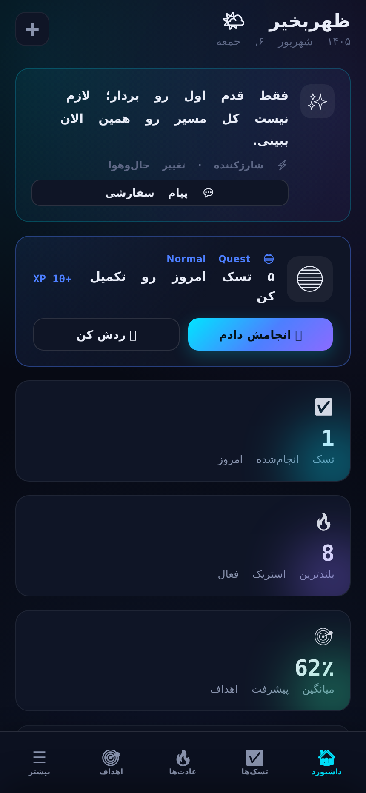
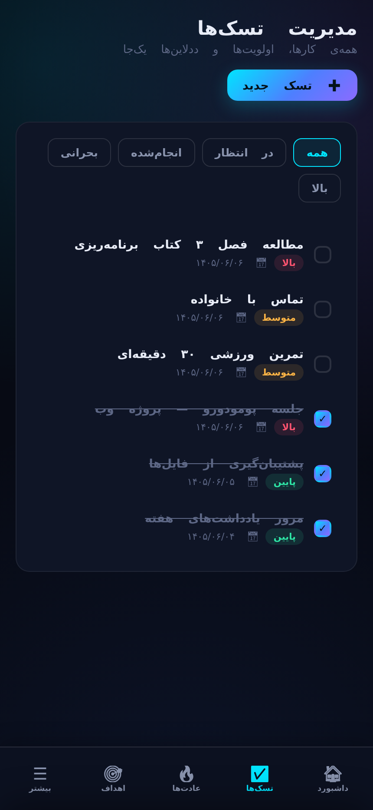
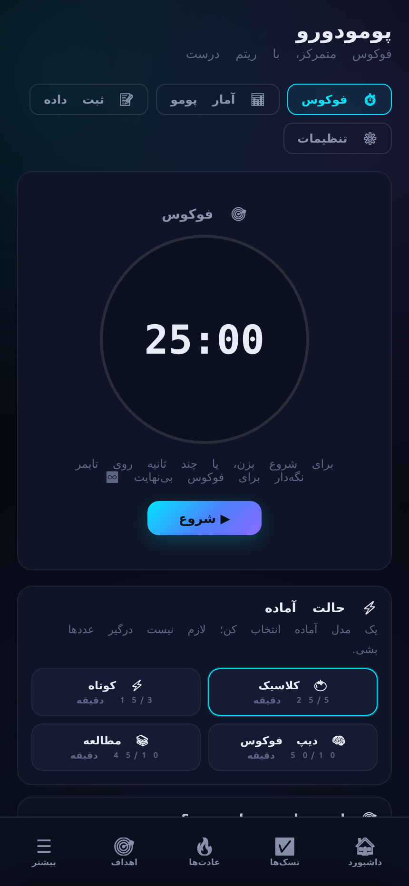
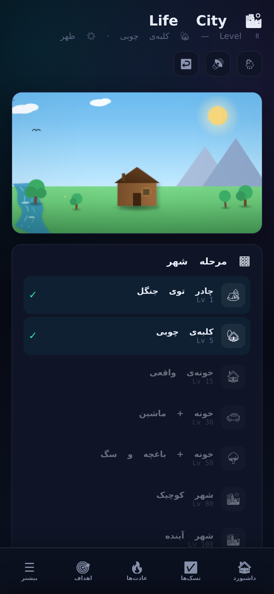
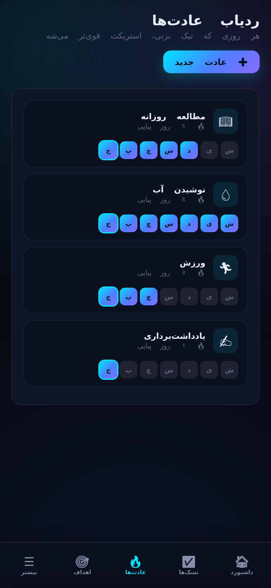
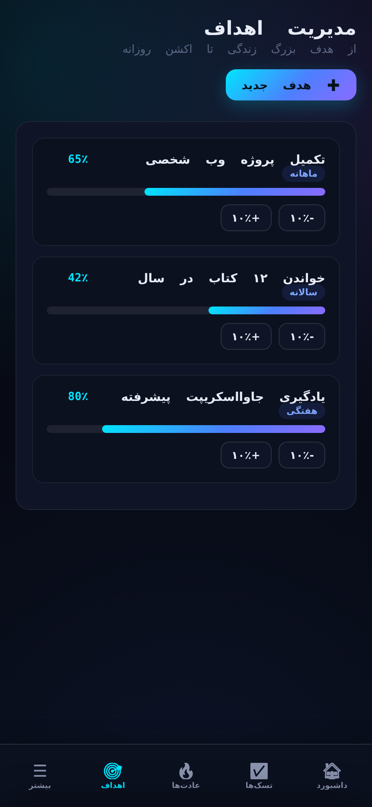
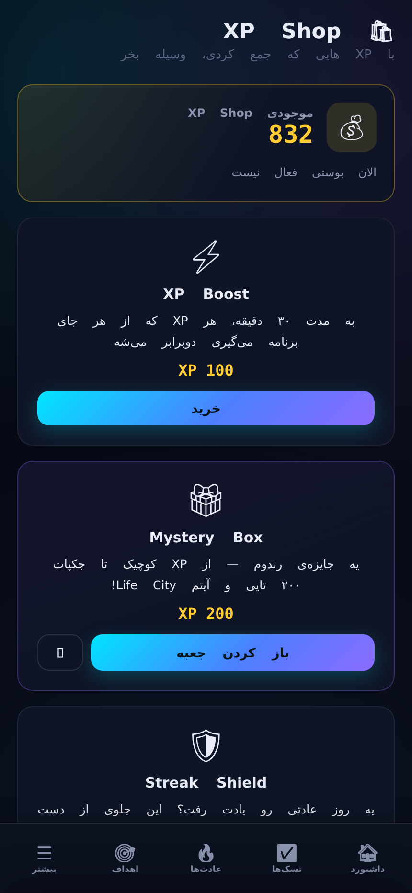

<div dir="rtl">

# 🌆 برنامه‌ریز هوشمند زندگی — Life Planner

<p align="center">
  
</p>

<p align="center">
  <b>سوپراپ مدیریت زمان، عادت‌ها، اهداف و تمرکز عمیق همراه با گیمیفیکیشن پیشرفته و بازی‌سازی زندگی</b><br>
  <i>ترکیبی از کارایی مدرن، طراحی چشم‌نواز فارسی (RTL)، بدون وابستگی (Zero Dependencies) و ۱۰۰٪ آفلاین‌محور (PWA)</i>
</p>

<p align="center">
  
  
  
  
  
</p>

---

🌐 Live Demo
https://karoangus.github.io/Life-Planner/
## 📌 فهرست مطالب

- [✨ نگاه کلی و تمایزها](#-نگاه-کلی-و-تمایزها)
- [🖼️ گالری تصاویر و پیش‌نمایش محیط برنامه](#️-گالری-تصاویر-و-پیشنمایش-محیط-برنامه)
- [⚡ خلاصه جامع امکانات و قابلیت‌ها](#-خلاصه-جامع-امکانات-و-قابلیتها)
  - [📋 مدیریت پیشرفته تسک‌ها و وظایف](#1--مدیریت-پیشرفته-تسکها-و-وظایف)
  - [🍅 موتور تمرکز و پومودورو حرفه‌ای](#2--موتور-تمرکز-و-پومودورو-حرفهای-focus-to-do-edition)
  - [🎮 اکوسیستم گیمیفیکیشن و بازی‌سازی زندگی](#3--اکوسیستم-گیمیفیکیشن-و-بازیسازی-زندگی-gamification--rpg)
  - [📅 تقویم تعاملی و زمان‌بندی هوشمند](#4--تقویم-تعاملی-و-زمانبندی-هوشمند)
  - [🔥 ردیاب عادت‌ها و زنجیره پایبندی](#5--ردیاب-عادتها-و-زنجیره-پایبندی-streaks)
  - [🎯 مدیریت اهداف چندسطحی](#6--مدیریت-اهداف-چندسطحی-multi-tier-goals)
  - [📝 دفترچه یادداشت سازمان‌یافته](#7--دفترچه-یادداشت-سازمانیافته)
  - [⚙️ شخصی‌سازی، تم‌ها و مقیاس رابط کاربری](#8--شخصیسازی-تمها-و-مقیاس-رابط-کاربری)
  - [📖 راهنمای بخش‌ها و شروع سه‌قدمی](#9--راهنمای-بخشها-و-شروع-سه‌قدمی)
- [🏗️ معماری فنی و ساختار پروژه](#️-معماری-فنی-و-ساختار-پروژه)
- [🚀 راهنمای نصب و اجرای سریع](#-راهنمای-نصب-و-اجرای-سریع)
- [📱 راهنمای نصب به عنوان PWA](#-راهنمای-نصب-به-عنوان-pwa-روی-موبایل-و-دسکتاپ)
- [🧪 راهنمای تست و کنترل کیفیت](#-راهنمای-تست-و-کنترل-کیفیت)
- [🔢 راهنمای به‌روزرسانی و توسعه نسخه جدید](#-راهنمای-بهروزرسانی-و-توسعه-نسخه-جدید)
- [🆕 تاریخچه تغییرات نسخه‌های اخیر](#-تاریخچه-تغییرات-نسخههای-اخیر)
- [🌐 English Overview](#-english-overview)

---

## ✨ نگاه کلی و تمایزها

**Life Planner** فقط یک لیست ساده از کارهای روزمره نیست؛ این سیستم طراحی شده تا روزمرگی شما را به یک سفر هیجان‌انگیز RPG تبدیل کند:

1. **⚡ بدون هیچ وابستگی و بیلد (Zero Dependencies / Pure Vanilla):** کل برنامه با HTML5، CSS3 مدرن و جاوااسکریپت خام پیاده‌سازی شده؛ بدون کتابخانه‌های سنگین و بدون نیاز به هیچ ابزار بیلد (مانند Webpack یا Vite).
2. **🔒 امنیت و حریم خصوصی مطلق (Local-First):** تمامی داده‌ها درون `localStorage` مرورگر دستگاه کاربر ذخیره می‌شوند. هیچ داده‌ای به هیچ سروری ارسال نمی‌شود و هیچ ردیابی وجود ندارد.
3. **📴 کارکرد کاملاً آفلاین (Offline PWA):** به کمک Service Worker، بعد از اولین بارگذاری می‌توانید از برنامه حتی بدون دسترسی به اینترنت استفاده کنید.
4. **🎮 گیمیفیکیشن عمیق و اصولی:** با انجام کارها، XP کسب کنید، سطح (Level) خود را بالا ببرید، شهری به نام **Life City** بسازید، در برابر باس‌های هفتگی بجنگید و مهارت‌های جدید در درخت مهارت آزاد کنید.
5. **🇮🇷 طراحی استاندارد فارسی و راست‌به‌چپ (RTL):** تایپوگرافی، آیکون‌ها، تقویم و چیدمان‌ها با دقت بالا برای کاربران فارسی‌زبان بهینه‌سازی شده‌اند.

---

## 🖼️ گالری تصاویر و پیش‌نمایش محیط برنامه

<div align="center">

| 📱 داشبورد مرکزی (Command Center) | ✅ مدیریت تسک‌ها (Task Workflow) |
|:---:|:---:|
|  |  |
| *نمای کلی روز، پیشرفت کل، کوئست فعال و آمارهای کلیدی* | *فیلترهای وضعیتی، اولویت‌ها، زیرتسک‌ها و ددلاین‌ها* |

| 🍅 پومودورو و تمرکز عمیق (Deep Focus) | 🏙️ شهر مجازی من (Life City) |
|:---:|:---:|
|  |  |
| *چرخه‌های ۴ جلسه‌ای، پریست‌های سفارشی و صداهای محیطی آفلاین* | *رشد تمدن شخصی از چادر جنگلی تا کلان‌شهر سایبرپانک* |

| 🔥 ردیاب عادت‌ها و زنجیره (Habits Tracker) | 🎯 سیستم اهداف چندسطحی (Goals System) |
|:---:|:---:|
|  |  |
| *ثبت استریک پیاپی، محافظ زنجیره و ماتریس هفتگی* | *سطوح روزانه تا مادام‌العمر همراه با نوار پیشرفت هوشمند* |

| 🛍️ فروشگاه ارتقا و جوایز (XP Shop) |
|:---:|
|  |
| *خرید بوست‌های XP، محافظ استریک، تم‌های اختصاصی و Mystery Box* |

</div>

---

## ⚡ خلاصه جامع امکانات و قابلیت‌ها

### 1. 📋 مدیریت پیشرفته تسک‌ها و وظایف
- **❓ راهنمای بخش و فرم صادقانه (جدید در v21.3):** دکمه‌ی «❓» کنار «➕ تسک جدید» چهار ردیف کوتاه درباره‌ی همین بخش می‌گوید (تسک جدید، چهار تب، تیک = XP، جزئیات بیشتر) و در پایان مستقیم فرم تسک را باز می‌کند. داخل همان فرم هم روی دسته‌بندی، ددلاین، اولویت، وضعیت و زمان تخمینی برچسب «(اختیاری)» نشسته است؛ تنها فیلدِ لازم، عنوان است.
- **شمارنده‌ی قرمز Inbox (جدید در v18):** کنار تب Inbox، تعداد زنده‌ی تسک‌های داخل صندوق با نشان قرمز دیده می‌شود و پس از افزودن، تبدیل یا حذف تسک به‌روز می‌ماند.
- **تب‌های خلوت و کاربردی (جدید در v16):** نوار تب‌های بخش تسک‌ها به چهار تب *همه*، *شروع نشده*، *Inbox* و *تکمیل‌شده* کاهش پیدا کرده است؛ تب‌های *در حال انجام*، *در صف* و *متوقف* حذف شدند (وضعیت هر تسک همچنان از منوی جزئیات همان تسک قابل تغییر است).
- **تکمیل‌شده‌ها به شکل تب (جدید در v16):** تسک‌های انجام‌شده به‌جای یک بلوک همیشه‌باز در بالای صفحه، داخل تب «✅ تکمیل‌شده» با شمارنده‌ی زنده قرار گرفته‌اند تا فضای کارهای باز بیشتر شود.
- **چهار وضعیت کاری (Workflow States):** امکان دسته‌بندی تسک‌ها به وضعیت‌های *شروع‌نشده*، *در حال انجام*، *در صف* و *متوقف* از منوی جزئیات هر تسک.
- **رنگ‌بندی داینامیک وضعیت:** کارت‌های تسک در صفحه تسک‌ها و بخش «برنامه امروز» در داشبورد بر اساس وضعیت خود رنگ‌آمیزی می‌شوند (سبز برای در حال انجام، آبی برای در صف، نارنجی برای متوقف).
- **سیستم زیرتسک‌های سلسله‌مراتبی (Subtasks):** تعریف چندین ریزتسک برای هر تسک اصلی همراه با نمایش پیشرفت درصدی؛ تیک خوردن تمام زیرتسک‌ها به صورت خودکار تسک مادر را تکمیل می‌کند.
- **ددلاین‌های ترکیبی و چندگانه (Additional Deadlines):** پشتیبانی از چند ددلاین برای پروژه‌های چندمرحله‌ای و حضور خودکار در برنامه امروز داشبورد.
- **انتخابگر تصادفی تسک (Random Task Picker):** رفع قفل ذهنی و اهمال‌کاری با انتخاب هوشمند و رندوم یکی از تسک‌های باز متناسب با فیلتر فعال.
- **اینباکس سریع (Quick Inbox):** ثبت فوری ایده‌ها و کارها در چند ثانیه و دسته‌بندی و تعیین جزئیات در زمان مناسب.
- **منوی اکشن کامل:** مشاهده سریع پاداش‌های XP، اولویت، دسته، زمان تخمینی و یادداشت تسک با یک لمس ساده.

### 2. 🍅 موتور تمرکز و پومودورو حرفه‌ای (Focus To-Do Edition)
- **ساختار دوره‌ها و جلسات (Cycles & Sessions):** سازمان‌دهی چرخه‌های تمرکز به صورت جلسات ۴ تایی همراه با نقطه‌های بصری (🍅 🍅 ⚪ ⚪).
- **پریست‌های متنوع و منعطف:**
  - *کلاسیک:* ۲۵ دقیقه تمرکز / ۵ دقیقه استراحت
  - *دیپ فوکوس (Deep Focus):* ۶۰ دقیقه تمرکز عمیق / ۱۵ دقیقه استراحت
  - *مطالعه:* ۴۵ دقیقه تمرکز / ۱۰ دقیقه استراحت
  - *کوتاه:* ۱۵ دقیقه تمرکز / ۳ دقیقه استراحت
  - *پریست سفارشی:* تنظیم دلخواه دقایق تمرکز و استراحت با ذخیره دائم در حافظه.
- **استراحت طولانی خودکار (Long Break):** ورود خودکار به استراحت طولانی ۱۵ دقیقه‌ای پس از اتمام هر دوره کامل ۴ جلسه‌ای.
- **حالت تمرکز تمام‌صفحه سینمایی (Full-Screen Zen Focus):** محیطی کاملاً بدون حواس‌پرتی با تایمر دقیق، ساعت زنده و کنترل‌های سریع.
- **سیستم صداهای محیطی آفلاین (Ambient Soundscapes):**
  - 🌧️ باران و رعد آرام
  - 🌲 جنگل و چهچهه پرندگان
  - ☕ فضای کافه دنج
  - 🌊 امواج ملایم اقیانوس
  - 🔥 آتش هیزمی و شومینه
  - ⏰ تیک‌تاک ساعت مکانیکی
  - 🌌 فضای تمرکز عمیق (Deep Space)
  - همراه با اسلایدر تنظیم بلندی صدا و پخش پیوسته و بدون وقفه.
- **پیوند تایمر به تسک فعال:** انتخاب تسک هنگام شروع تمرکز و امکان ثبت فوری انجام تسک بلافاصله پس از اتمام تایمر.
- **آمار یکدست (ساده‌تر در v21.7):** تب آمار یک زبان بصری دارد — فوکوس امروز، هدف روزانه، هفت روز اخیر، نمودار روند، جمع‌بندی فوکوس و ۱۰ جلسه‌ی آخر؛ هر عدد فقط یک بار نوشته می‌شود (نه یک بار ساعت و یک بار دقیقه) و همه با ارقام فارسی.
- **اعلانِ به‌موقع، نه اعلانِ دائمی (v21.7):** اعلان‌ها فقط سه‌جا می‌آیند — شروع جلسه، پایان جلسه و پایان دور. اعلانِ زنده‌ای که هر ۵ ثانیه بازنویسی می‌شد تا شمارش معکوس را نشان بدهد حذف شد و کلید روشن/خاموش اعلان‌ها به تب «⚙️ تنظیمات» رفت (پیش از این فقط یک جمله‌ی ثابت «نوتیفیکیشن هوشمند فعاله» بود که هیچ کلیدی نداشت). زنگ هشدار دوضربی پایان جلسه با ویبره گوشی سر جایش است.

### 3. 🎮 اکوسیستم گیمیفیکیشن و بازی‌سازی زندگی (Gamification & RPG)
- **🏙️ شهر هوشمند من (Life City):**
  - شهری که با افزایش بهره‌وری و سطح شما تکامل می‌یابد:
    1. لول ۱: چادر توی جنگل 🏕️
    2. لول ۵: کلبه چوبی 🏡
    3. لول ۱۵: خانه واقعی 🏠
    4. لول ۳۰: خانه با ماشین 🚗
    5. لول ۵۰: خانه با باغچه و سگ 🌳
    6. لول ۸۰: شهر کوچک 🏙️
    7. لول ۱۰۰: کلان‌شهر سایبرپانک و آینده 🌆
  - گرافیک وکتوری پرجزئیات همراه با چرخه زنده روز، شب و باران، و صدای محیطی واقعی شهر.
  - نشستن اشیای تزئینی Mystery Box (درخت، نیمکت، چراغ نئونی، فواره و برج) درون محیط شهر.
- **⚔️ باس فایت هفتگی (Weekly Boss Battles):** تبدیل اهداف بزرگ هفته به یک نبرد حماسی با نوار سلامتی (HP)؛ وارد کردن ضربه به باس با تکمیل تسک‌های متصل و مهلت ۱۴ روزه برای شکست نهایی. از v21.7 تسک‌های خودِ باس را می‌شود همان‌جا داخل صفحه‌ی انتخاب تسک ساخت (بدون بستن پنجره و رفتن به بخش تسک‌ها) — تسک تازه خودش برای باس انتخاب می‌شود و بعداً در بخش تسک‌ها هم هست.
- **🌳 درخت مهارت (Skill Tree):** ارتقای مهارت‌های دائمی با امتیازهای مهارت دریافتی در هر لول‌آپ:
  - *استاد فوکوس:* افزایش درصدی XP جلسات پومودورو
  - *شکارچی کوئست:* افزایش XP مأموریت‌های تصادفی
  - *چانه‌زن:* تخفیف روی تمامی اقلام فروشگاه XP
  - *شانس بلند:* شانس دریافت جعبه شگفت‌انگیز رایگان
  - *قاتل بحران:* پاداش مضاعف برای حل تسک‌های حالت بحران
  - *محافظ استریک:* دریافت مستقیم Streak Shield رایگان
  - *کوئست سریع:* کاهش زمان انتظار کوئست‌های تصادفی در ۵ تیر (از ۲۰ به ۱۵ دقیقه)
- **🪞 رقابت با خود دیروز (You VS You):** سیستم هوشمند مقایسه عملکرد امروز با بهترین رکورد ثبت‌شده شخصی و مقایسه هفته جاری با هفته پیشین.
- **🛍️ فروشگاه جوایز (XP Shop):**
  - *XP Boost:* دو برابر شدن تمام XPهای دریافتی به مدت ۳۰ دقیقه
  - *Mystery Box:* جعبه شگفت‌انگیز حاوی XP جکپات و آیتم‌های جدید برای شهر
  - *Streak Shield (سپر استریک):* محافظت از قطع شدن زنجیره عادت‌ها در روزهای فراموش‌شده با قوانین ضد اسپم (سقف خرید هفتگی حداکثر ۳ عدد و نگهداری ۱ عدد در هر زمان).
- **⚡ مأموریت‌های تصادفی روزانه (Quests):** پیشنهاد مأموریت‌های روزانه با درجات سختی متنوع (Easy تا Special)، پاداش فوری و تایمر اختصاصی؛ اگر شرایط انجامش رو نداشتی با دکمه‌ی «🚫 شرایط انجامش رو ندارم» بدون کسر XP ردش کن (مأموریت بعدی ۵ دقیقه بعد می‌رسه) — «⏭️ ردش کن (با جریمه)» و تموم شدن مهلت مأموریت هر دو دقیقاً یک مقدار XP کم می‌کنن و کول‌داون عادی (۲۰ دقیقه، قابل کاهش با مهارت «کوئست سریع») دارن. با تیک «🌴 مرخصی» پایین همین کارت هم می‌تونی هر وقت خواستی کوئست‌ها رو کامل متوقف کنی (بدون کسر XP) و با برداشتن تیک دوباره برشون گردونی.
- **🌟 جشن روز طلایی (Perfect Day):** جشن بصری ویژه و دریافت پاداش مضاعف در صورت تکمیل ۱۰۰٪ مأموریت‌ها و برنامه‌های روز.
- **🚨 حالت بحران (Crisis Mode):** فعال‌سازی پوسته هشدار اضطراری و شمارش معکوس زمانی که کارهای حیاتی عقب افتاده‌اند.

### 4. 📅 تقویم تعاملی و زمان‌بندی هوشمند
- **معرفی یک‌خطی + راهنمای کامل (جدید در v21.3):** متنِ بالای تقویم به یک خط خلاصه شد («رویداد را بکش تا جابه‌جا شود؛ لبه‌اش را نگه دار تا مدتش عوض شود.») و توضیحِ کاملِ حرکت‌ها، «الان»/«امروز» و دسته‌های رنگی به راهنمای بخش رفت که با دکمه‌ی «❓ راهنما» کنار همان خط باز می‌شود.
- تقویم جلالی (شمسی) و میلادی کامل و دقیق.
- **تقویم ساده‌تر (v20):** هفته را با دو دکمه‌ی «هفته قبل» / «هفته بعد» جابه‌جا کن و با «امروز» برگرد. بخش «برنامه روز» و نماهای Agenda و قالب‌ها حذف شدند تا تقویم فقط یک چیز باشد: رویدادهای هفته.
- **بلوک‌بندی ساعتی ۶ صبح تا ۳ بامداد (جدید در v17.1):** هر ستونِ روز ۲۱ بلوک یک‌ساعته دارد که از ۰۶:۰۰ شروع می‌شود و تا ۰۳:۰۰ بامدادِ روز بعد ادامه دارد؛ ساعت‌های بعد از نیمه‌شب با رنگ بنفش جدا شده‌اند و رویدادهای شبانه یک‌تکه کشیده می‌شوند.
- **نشانگر دقیق زمان و افزودن سریع (جدید در v17.2):** خط زمانِ فعلی دقیقه‌به‌دقیقه و هم‌زمان با رفتن به ساعت بعد جابه‌جا می‌شود؛ تاریخ جلالی هر روز هم در سربرگ دیده می‌شود. روی بخش خالی هر ساعت بزن تا فرم «رویداد جدید» با روز و زمان همان بخش آماده شود.
- **کشیدن و رها کردن رویدادها (Drag & Drop):** تغییر زمان یا روز رویدادها با نگه‌داشتن و کشیدن در شبکه هفتگی، همراه با اسنپ ۱۵ دقیقه‌ای و بررسی تداخل ساعت‌ها.
- **تغییر مدت با کشیدن لبه‌ها (جدید در v18.2):** لبه‌ی بالا یا پایین هر بلوک را بکش تا ساعت شروع/پایان همان‌جا روی شبکه عوض شود؛ پیش‌نمایش زنده‌ی «شروع تا پایان · مدت»، خط راهنمای اسنپ، هشدار قرمز هنگام تداخل، پشتیبانی از بعد از نیمه‌شب و جدا شدن فقط همان روز از رویدادهای چندروزه، میانبر `↑`/`↓` (و `Shift+↑`/`↓` برای شروع) و دکمه‌ی «برگرداندن» بعد از هر تغییر.
- **ریزایز خلوت و بدون تغییر ناخواسته (جدید در v18.3):** خط‌های دستگیره دیگر روی موبایل همیشه دیده نمی‌شوند و در دسکتاپ فقط با بردن نشانگر روی بلوک ظاهر می‌شوند. لمس یا لرزش کوتاهِ انگشت زمان را عوض نمی‌کند؛ برای ثبت تغییر باید لبه را واقعاً بکشید.
- **لبه‌ها جابه‌جایی را نمی‌دزدند (جدید در v21.2):** نوعِ حرکت تصمیم می‌گیرد، نه نقطه‌ی تماس. روی موبایل کشیدنِ لبه رویداد را جابه‌جا می‌کند و فقط نگه‌داشتنِ لبه (یک ویبره و روشن شدن دستگیره) آن را به حالت تغییر مدت می‌برد؛ با ماوس کشیدنِ عمودی لبه مدت را عوض می‌کند و کشیدنِ افقی‌اش رویداد را به روز دیگر می‌برد. `Escape` هر حرکتی را لغو می‌کند و دکمه‌ی «↩️ برگرداندن» هم بعد از ریزایز و هم بعد از جابه‌جایی واقعاً کار می‌کند و فقط همان یک رویداد را برمی‌گرداند.
- **افزودن رویداد با تشخیص فضای خالی (جدید در v18.3):** زدن هر جای خانه‌ی یک ساعت، رویداد را از ابتدای همان ساعت آماده می‌کند؛ اگر ابتدای ساعت اشغال باشد، شروع را به اولین دقیقه‌ی آزاد می‌برد. مدت تا رویداد بعدی (حداکثر یک ساعت) اندازه می‌شود، پس فاصله‌ی خالیِ ۴۵ دقیقه‌ای دقیقاً به رویداد ۴۵ دقیقه‌ای تبدیل می‌شود.
- **مدیریت پیشرفته رویدادهای چندروزه:** امکان ویرایش تکیِ فقط یک روز خاص از یک رویداد زنجیره‌ای، یا ویرایش سراسری کل روزها.
- دسته‌بندی‌های رنگی رویدادها و وظایف با پالت رنگ‌های جذاب.

### 5. 🔥 ردیاب عادت‌ها و زنجیره پایبندی (Streaks)
- **❓ راهنمای بخش (جدید در v21.4):** دکمه‌ی «❓» کنار «➕ عادت جدید» همان پنجره‌ی راهنمای مشترک را باز می‌کند: یک جمله درباره‌ی کاربرد بخش، چهار ردیف کوتاه (عادت جدید، خانه‌ی امروز، استریک و XP، محافظت Streak Shield)، یک خط درباره‌ی راه‌های گرفتن سپر، و در پایان دکمه‌ای که مستقیم فرم عادت را باز می‌کند.
- **ویرایش عادت (جدید در v16):** با دکمه‌ی «✏️» روی هر کارت عادت می‌توانی نام و ایموجی آن را تغییر بدهی؛ زنجیره و تاریخچه‌ی تیک‌ها دست‌نخورده می‌ماند.
- ثبت و دنبال کردن زنجیره روزانه (Current Streak) و بهترین رکورد (Best Streak) در پروفایل.
- ماتریس هفتگی بصری وضعیت تکمیل عادات که **فقط خانه‌ی امروزش تیک می‌خورد**؛ از v21.4 این ماتریس همیشه هفته‌ی جاری را نشان می‌دهد، پس جابه‌جاییِ هفته در تقویم دیگر هفت خانه‌ی بی‌استفاده جلوی چشم نمی‌گذارد.
- هر تیک ۶ XP می‌دهد — از v21.4 برای هر عادت **روزی یک بار**، بنابراین برداشتن و دوباره زدنِ تیک راهِ XP گرفتن نیست.
- محافظت خودکار از زنجیره‌ها به کمک Streak Shield در صورت فعال بودن (با یک سپر، همه‌ی عادت‌های جا‌مانده‌ی دیروز نجات پیدا می‌کنند).
- **حذف با تأیید (جدید در v21.4):** حذف عادت هم مثل تسک و یادداشت اول سؤال می‌پرسد («این عادت حذف بشه؟») و بعد پیام می‌دهد؛ پیش از این یک لمس اشتباه کل تاریخچه را می‌پرد.

### 6. 🎯 مدیریت اهداف چندسطحی (Multi-Tier Goals)
- تعریف هدف در ۵ افق زمانی: *روزانه*، *هفتگی*، *ماهانه*، *سالانه* و *مادام‌العمر*.
- **گام‌های دقیق پیشرفت (جدید در v16):** در کنار دکمه‌های «-۱۰٪» و «+۱۰٪» حالا دکمه‌های «-۲٪» و «+۲٪» هم وجود دارند تا پیشرفت اهداف را دقیق‌تر ثبت کنی.
- **ویرایش هدف (جدید در v16):** با دکمه‌ی «✏️» روی هر کارت هدف می‌توانی عنوان، سطح و درصد پیشرفت آن را ویرایش کنی.
- **❓ راهنمای بخش (جدید در v21.4):** چهار ردیف کوتاه درباره‌ی ساخت هدف، چهار دکمه‌ی روی کارت، ثبتِ جداگانه‌ی پیشرفتِ امروز و پاداش‌ها؛ دکمه‌ی پایانش فرم هدف را باز می‌کند.
- **ثبت جداگانه‌ی پیشرفت هر روز:** هر درصدی که امروز اضافه می‌کنی برای همان روز نگه داشته می‌شود، پس «امروز چقدر جلو رفتم» با درصدِ کلیِ هدف قاطی نمی‌شود. شرط «روز عالی» (حداقل ۱۰٪ پیشرفت در یک هدف) روی همین داده حساب می‌شود.
- رسیدن از کمتر از ۱۰۰٪ به ۱۰۰٪ یعنی ۴۰ XP.
- **ارقام فارسی (جدید در v21.4):** درصدِ روی کارت مثل بقیه‌ی برنامه با ارقام فارسی نوشته می‌شود (در حالت انگلیسی خودکار لاتین می‌شود).
- **حذف با تأیید (جدید در v21.4):** مثل تسک، یادداشت و عادت.

### 7. 📝 دفترچه یادداشت سازمان‌یافته
- یادداشت‌برداری سریع و بدون تأخیر؛ فقط **عنوان** اجباری است و متن، برچسب، رنگ و سنجاق اختیاری‌اند. زیر متن هم شمارنده‌ی زنده‌ی «N کلمه · M کاراکتر» نشسته است.
- قابلیت سنجاق کردن (Pin) یادداشت‌های مهم به بالای لیست — سنجاق‌شده‌ها در هر ترتیبی اول می‌آیند.
- دسته‌بندی موضوعی با برچسب و جست‌وجوی لحظه‌ای که نتیجه را هایلایت می‌کند (هم‌زمان در عنوان، متن و برچسب).
- چهار ترتیب (جدیدترین، قدیمی‌ترین، عنوان، طولانی‌ترین)، دو نمای شبکه‌ای/لیستی، شمارنده‌ی «X از Y یادداشت» و دکمه‌ی «🧹 پاک کردن فیلتر» که فقط وقتی فیلتری فعال باشد ظاهر می‌شود.
- پنج کار سریع روی هر کارت: ویرایش، سنجاق/برداشتن سنجاق، کپیِ یادداشت، کپیِ متن روی کلیپ‌بورد و حذف (با تأیید).
- **❓ راهنمای بخش (جدید در v21.4):** همان پنجره‌ی مشترک، با چهار ردیف درباره‌ی نوشتن، جست‌وجو و برچسب، سنجاق و ترتیب، و کارهای روی کارت.
- **دکمه‌ی نما وضعیت را نشان می‌دهد (جدید در v21.4):** `▦` یعنی در نمای شبکه‌ای هستی و `☰` یعنی در نمای لیستی؛ tooltip هم می‌گوید با یک کلیک به کدام نما می‌روی (پیش از این آیکون هیچ‌وقت عوض نمی‌شد).

### 8. ⚙️ شخصی‌سازی، تم‌ها و مقیاس رابط کاربری
- **۵ تم بصری متنوع:**
  - 🌙 تم تاریک پیش‌فرض (Dark)
  - ☀️ تم روشن (Light)
  - 💜 بنفش نئون (Neon Purple)
  - 🌇 غروب آتشین (Fire Sunset)
  - 👑 طلایی افسانه‌ای (Legendary Gold)
- **🌐 انتخاب زبان برنامه (جدید در v15):** زبان پیش‌فرض **فارسی (RTL)** است و از مسیر **تنظیمات ← «🌐 زبان برنامه»** می‌توان کل رابط را به **English (LTR)** تغییر داد. داده‌های نوشته‌شده توسط کاربر هرگز ترجمه نمی‌شوند.
- **تنظیم مقیاس رابط کاربری و فونت:** امکان کوچک یا بزرگ کردن سایز متون و عناصر به تناسب ابعاد صفحه گوشی یا مانیتور.
- **نوار پایین با حداقل دو دکمه (جدید در v18):** تعداد دکمه‌های ردیف اصلی را به انتخاب خودت از ۲ تا ۴ تنظیم کن؛ حالت دو دکمه یعنی دقیقاً دو میان‌بر به‌علاوه‌ی «بیشتر». دکمه‌های ردیف دوم اختیاری‌اند و تا ۵ مورد قابل افزودن هستند؛ چیدمان در پشتیبان هم ذخیره می‌شود.
- **پشتیبان‌گیری خودکار و دستی:** تولید فایل خروجی JSON از تمامی داده‌ها، بازیابی آسان و سیستم یادآوری و بکاپ‌گیری خودکار روزانه.
- **لودینگ اسکلتی و انیمیشن اسکرول (جدید در v16):** به‌جای اسپینر تمام‌صفحه، تا آماده شدن داده‌ها «اسکلت» خاکستری همان آیتم‌ها نمایش داده می‌شود و آیتم‌هایی که به سمتشان اسکرول می‌کنی با انیمیشن ملایم از پایین بالا می‌آیند.
- **حالت سبک برای گوشی‌های ضعیف (جدید در v16):** روی دستگاه‌های کم‌قدرت، سایه و گرادیان تزئینی ردیف‌های تکراری و رندر ردیف‌های بیرون از صفحه بهینه می‌شود؛ چیدمان، رنگ‌ها و همه‌ی دکمه‌ها دقیقاً مثل قبل می‌مانند.

### 9. 📖 راهنمای بخش‌ها و شروع سه‌قدمی
- **❓ راهنمای ده بخش (v21.3، کامل‌شده در v21.7):** داشبورد، تسک‌ها، تقویم، عادت‌ها، اهداف، یادداشت‌ها، پومودورو، XP Shop، درخت مهارت و باس هفتگی هر کدام یک دکمه‌ی «❓» دارند که یک پنجره‌ی راهنمای مشترک را باز می‌کند. ده تب داخل پنجره است، پس از هر بخش می‌شود به راهنمای بخش دیگر رفت. هر راهنما یک جمله درباره‌ی کاربرد بخش دارد، چهار ردیف کوتاه درباره‌ی چیزی که روی صفحه دیده می‌شود، و یک دکمه که مستقیم به کارِ اصلی همان بخش می‌برد — از «➕ تسک جدید» تا «▶️ شروع جلسه‌ی فوکوس»، «🎁 شانس‌های جعبه»، «🛍️ برو به XP Shop» و «⚔️ ساخت باس» (که وقتی نبردی در جریان است «✏️ ویرایش باس» می‌شود).
- **👋 اشاره‌ی یک‌بارمصرف:** اولین باری که داشبورد، تسک‌ها، عادت‌ها، اهداف، یادداشت‌ها، پومودورو، XP Shop، درخت مهارت یا باس هفتگی باز شود، یک نوار باریکِ داخلِ بخش (نه پنجره‌ی مزاحم) می‌گوید آن بخش برای چیست؛ با «✕»، با خواندن راهنما یا فقط با رفتن به بخش دیگر برای همیشه می‌رود. تقویم از این نوار معاف است چون معرفیِ دائمیِ یک‌خطیِ خودش را دارد.
- **🚀 سه قدم اول:** روی حساب کاملاً خالی، کارتِ سه‌مرحله‌ی «یه کار بنویس ← تیکش بزن ← تو تقویم جاش بده» بالای داشبورد می‌آید. هر قدم از روی داده‌ی واقعی تیک می‌خورد و بعد از قدم سوم کارت با یک پیام تبریک برای همیشه می‌رود؛ کاربر قدیمی هرگز نمی‌بیندش.
- **⚙️ دسترسی از تنظیمات:** کارت «❓ راهنمای بخش‌ها» در تنظیمات هر ده راهنما را باز می‌کند و «↩️ نمایش دوباره‌ی راهنمای خودکار» همه‌ی اشاره‌ها و کارت سه‌قدمی را برمی‌گرداند.

---

## 🏗️ معماری فنی و ساختار پروژه

ساختار پروژه کاملاً تمیز، ماژولار و بدون نیاز به هیچ کامپایلر یا باندلری طراحی شده است:

```
Life-Planner/
│
├── index.html                  # بدنه اصلی برنامه (ساختار صفحات، مودال‌ها و چیدمان PWA)
├── app-version.json            # تک‌منبع نسخه برنامه جهت بررسی خودکار آپدیت
├── manifest.json               # مانیفست PWA برای نصب روی موبایل و دسکتاپ
├── sw.js                       # Service Worker برای کش آفلاین و مدیریت به‌روزرسانی
├── icon-192.png / icon-512.png # آیکون‌های استاندارد رزولوشن بالا برای PWA
│
├── css/
│   └── app.css                 # استایل‌های برنامه، تم‌های ۵ گانه و انیمیشن‌های RTL
│
├── js/
│   ├── core.js                 # هسته مرکزی: DB لوکال، رندرینگ، گیمیفیکیشن و تسک‌ها
│   ├── pomodoro.js             # ماژول مستقل پومودورو، صداهای امبینت و حالت ذن
│   ├── enhancements.js         # ماژول تنظیمات، مدیریت تم‌ها، مقیاس UI و بکاپ
│   ├── lang.js                 # لایه زبان: فارسی پیش‌فرض + ترجمه رابط به انگلیسی
│   └── sw-register.js          # رجیستر هوشمند Service Worker و مدیریت آپدیت‌ها
│
├── audio/                      # فایل‌های صوتی باکیفیت آفلاین (باران، کافه، جنگل، شهر)
├── docs/screenshots/           # تصاویر و اسکرین‌شات‌های مستندات برنامه
├── tests/
│   └── app.test.mjs            # تست‌های اعتبارسنجی کارکردی و دود (Smoke Tests)
└── ci/
    └── test.yml                # پایپ‌لاین CI/CD آماده برای GitHub Actions
```

> ⚠️ **نکته برای توسعه‌دهندگان:** ترتیب بارگذاری اسکریپت‌ها در `index.html` حیاتی است:  
> `core.js` ➔ `enhancements.js` ➔ `sw-register.js` ➔ `pomodoro.js` ➔ `lang.js`
>
> `lang.js` عمداً **آخرین** فایل است: این ماژول هیچ منطقی را تغییر نمی‌دهد و فقط متن‌های
> رابط کاربری را که روی صفحه آمده‌اند ترجمه می‌کند (با `MutationObserver`). به همین دلیل
> شناسه‌ها (ID)، کلاس‌ها و هندلرهای دکمه‌ها کاملاً دست‌نخورده باقی می‌مانند.

---

## 🚀 راهنمای نصب و اجرای سریع

از آنجا که این پروژه کاملاً استاتیک و بدون بیلد است، به دو روش می‌توانید آن را اجرا کنید:

### روش ۱ — اجرای محلی (Local):
کافی است فایل `index.html` را در مرورگر خود باز کنید.  
*(برای دسترسی کامل به قابلیت‌های PWA، نوتیفیکیشن‌ها و وب‌ورکرها، پیشنهاد می‌شود از یک سرور محلی سبک استفاده کنید:)*

```bash
# با استفاده از Node.js
npx serve .

# یا با استفاده از پایتون
python3 -m http.server 8080
```
سپس آدرس `http://localhost:8080` را در مرورگر باز کنید.

### روش ۲ — انتشار رایگان روی GitHub Pages:
1. این مخزن را در اکانت گیت‌هاب خود Fork یا Push کنید.
2. به بخش **Settings** > **Pages** در ریپازیتوری خود بروید.
3. در قسمت **Source**، شاخه `main` و مسیر `/ (root)` را انتخاب کرده و روی **Save** کلیک کنید.
4. آدرس برنامه به صورت `https://<username>.github.io/Life-Planner` در دسترس خواهد بود.

---

## 📱 راهنمای نصب به عنوان PWA (روی موبایل و دسکتاپ)

این برنامه یک **Progressive Web App (PWA)** کامل است و می‌تواند مثل یک اپلیکیشن بومی روی گوشی شما نصب شود:

- **📱 در گوشی‌های اندروید (Chrome / Edge):** سایت را باز کنید، روی منوی سه نقطه (⋮) مرورگر ضربه بزنید و گزینه **«نصب برنامه» (Install app)** یا **«افزودن به صفحه اصلی» (Add to Home screen)** را انتخاب کنید.
- **🍏 در گوشی‌های آیفون و آیپد (Safari):** سایت را در مرورگر سافاری باز کنید، روی دکمه‌ی Share (آیکون اشتراک‌گذاری در پایین صفحه) بزنید و گزینه **«Add to Home Screen»** را انتخاب نمایید.
- **💻 در کامپیوتر و لپ‌تاپ (Chrome / Edge):** در نوار آدرس مرورگر روی آیکون نصب (کامپیوتر کوچک در سمت راست نوار آدرس) کلیک کنید.

---

## 🧪 راهنمای تست و کنترل کیفیت

این پروژه دارای یک سوئیت تست کارکردی مستقل است که بارگذاری ساختار، ایجاد تسک، ثبت پیشرفت، محاسبات XP و سلامت رندر تمامی صفحات را بررسی می‌کند:

```bash
# اجرای تست‌ها
npm test
```

این تست‌ها در محیط CI گیت‌هاب نیز روی هر Push یا Pull Request اجرا می‌شوند.

---

## 🔢 راهنمای به‌روزرسانی و توسعه نسخه جدید

هنگام توسعه ویژگی‌های جدید و انتشار نسخه جدید، شماره نسخه باید در **همه‌ی محل‌های زیر با هم** ارتقا پیدا کند تا کاربرها به‌طور خودکار پیام به‌روزرسانی بگیرند:

1. فایل `app-version.json` ➔ کلید `"version"` (مثلاً `"21.0"`).
2. فایل `js/core.js` ➔ `const LP_APP_VERSION = '21.0';`
3. فایل `package.json` و نسخه‌ی ریشه در `package-lock.json` ➔ مثلاً `"21.0.0"`.
4. فایل `index.html` ➔ مقدار `id="settingsVersion"`.
5. فایل `README.md` ➔ نشان نسخه در بالای صفحه و بخش تاریخچه تغییرات.
6. فایل `sw.js` ➔ ارتقای نام کش:
   ```javascript
   const CACHE_NAME = 'life-planner-cache-v90';
   ```
7. اگر فایل `css`/`js` جدیدی اضافه شد، آن را هم در `index.html` (با `?v=`) و هم در لیست `SHELL` داخل `sw.js` قرار بده.

> ✅ پیش از باز کردن Pull Request حتماً `npm ci` و سپس `npm test` را اجرا کنید؛ همه‌ی تست‌ها باید سبز باشند.

---

## 🆕 تاریخچه تغییرات نسخه‌های اخیر

### ✨ نسخه 21.9 — «درگ بین روزها بدون گیر کردن»
ادامه‌ی روان‌سازی تقویم، این بار متمرکز روی جابه‌جایی افقی رویدادها بین روزهای هفته.

- 🧊 **هندسه‌ی ستون‌ها کش می‌شود:** در شروع درگ، موقعیت هر هفت ستون یک‌بار خوانده و در حافظه نگه داشته می‌شود؛ پیش از این هر فریم تا ۱۴ بار `getBoundingClientRect` (و در نتیجه محاسبه‌ی اجباری layout) صدا زده می‌شد و هنگام عبور از چند ستون صفحه به لرزش می‌افتاد.
- 🎯 **هدف گم نمی‌شود:** روی مرز یک‌پیکسلی بین ستون‌ها نزدیک‌ترین ستون انتخاب می‌شود و کمی آن‌طرف‌تر از لبه‌های بیرونی، آخرین ستون معتبر می‌چسبد؛ پس درگ بین روزها دیگر با حالت «هیچ روزی انتخاب نشده» و پریدن کارت به خانه‌ی اولش تمام نمی‌شود.
- 🚫 **حذف ترنزیشن از کارت در حال درگ:** کلون بلندشده قبلاً ترنسفورمش با ۱۶۰ میلی‌ثانیه انیمیت می‌شد، برای همین وسط جابه‌جایی افقی همیشه با تأخیر پشت انگشت می‌آمد و حس گیر می‌داد؛ حالا در حالت درگ هیچ ترنزیشنی نیست و کارت ۱:۱ زیر انگست و فقط انیمیشن فرود می‌ماند.
- 🪶 **نوشتن‌های DOM به حداقل رسید:** کلاس های‌لایت فقط هنگام عوض شدن ستون (روی دو ستون به‌جای هر هفت ستون در هر فریم) عوض می‌شود، گوست به‌جای حذف/ساخت دوباره فقط مخفی/نمایش داده می‌شود و برچسب روز و ساعتش با `textContent` و فقط هنگام تغییر به‌روز می‌شود.
- 🛑 **رفع ریشه‌ی گیر کردن بین روزها:** هر `save()` یک رندر سراسری زمان‌بندی می‌کند و این رندر وسط درگ، کل `#weekGrid` را از نو می‌ساخت؛ در نتیجه ستون‌های کش‌شده و گوست یتیم می‌شدند و رها کردن بلوک در روز دیگر بی‌صدا شکست می‌خورد. حالا تا وقتی ژستی (درگ/ریسایز) در جریان است نه `renderAll` و نه خود `renderCalendar` گرید را بازنمی‌سازند؛ رندر تازه بعد از پایان ژست توسط خود مسیر اعمال تغییر انجام می‌شود.
- ↗️ **درگ قطری لمسی هم کار می‌کند:** سرخوردن طبیعی مورب انگشت (افقی غالب) حالا بلوک را برمی‌دارد؛ حرکت عمودیِ واضح همچنان برای اسکرول صفحه دست‌نخورده ماند.
- ♻️ نسخه در هر شش محل به `21.9` رفت و نام کش سرویس‌ورکر به `const CACHE_NAME = 'life-planner-cache-v90';` تغییر کرد.

### ✨ نسخه 21.8 — «درگ و اسکرول روان» در تقویم هفتگی
به‌روزرسانی متمرکز روی حسِ لمسیِ تقویم: اسکرول صفحه و کشیدن رویدادها حالا خیلی نرم‌ترند و برای برداشتن یک بلوک نیازی به نگه‌داشتن طولانی انگشت نیست.

- 👆 **برداشتن سریع‌تر بلوک (به درخواست کاربر):** تأخیر نگه‌داشتن انگشت برای بلند شدن رویداد از ۳۴۰ به ۱۷۰ میلی‌ثانیه رسید، مسافت لازم برای شروع درگ افقی از ۱۰ به ۶ پیکسل کم شد و تأخیر مسلح‌شدن لبه برای تغییر مدت از ۳۰۰ به ۲۰۰ میلی‌ثانیه رسید — یک لمس کوتاه و حرکت ملایم کافی است و دیگر «گیر» نمی‌کند.
- 🎞️ **درگ GPU-محور:** کارت بلندشده به‌جای `left/top` با `translate3d` حرکت می‌کند (بدون layout در هر فریم)، رویدادهای اشاره با `requestAnimationFrame` در یک فریم تجمیع می‌شوند و فرود کارت در خانه‌ی مقصد فقط با ترنسفورم و شفافیت انیمیت می‌شود.
- 🌀 **اسکرول خودکار لبه‌ی صفحه نرم شد:** به‌جای پرش ثابت ۱۶ پیکسلی در هر فریم، سرعت اسکرول با فاصله‌ی انگشت از لبه به‌صورت تدریجی کم‌وزیاد می‌شود (هم برای جابه‌جایی و هم برای تغییر مدت).
- 🛝 **اسکرول صفحه روان‌تر:** کل شبکه‌ی تقویم به یک لایه‌ی GPU ارتقا پیدا کرد تا هنگام اسکرول، گرادیان و سایه‌ی بلوک‌ها دوباره رنگ‌آمیزی نشوند؛ `scroll-behavior:smooth` سراسری که با اسکرول فریم‌به‌فریم درگ تداخل می‌کرد حذف شد و اسکرول دکمه‌ی «امروز» با انیمیشن اختصاصی `easeOutCubic` و احترام به `prefers-reduced-motion` انجام می‌شود.
- 🧷 **محافظت درگ در برابر رندر دوره‌ای:** بازه‌ی رندر ۳۰ ثانیه‌ای تقویم وسط یک درگ یا ریسایز فعال دیگر صفحه را از نو نمی‌سازد و ژست را خراب نمی‌کند.
- ♻️ نسخه در هر شش محل به `21.8` رفت و نام کش سرویس‌ورکر به `const CACHE_NAME = 'life-planner-cache-v89';` تغییر کرد.

### ✨ نسخه 21.7 — «راهنمای ده بخش» + پاک‌کاری پومودورو، XP Shop، درخت مهارت و باس هفتگی
ادامه‌ی مسیر ساده‌سازی. چهار بخشِ باقی‌مانده هم راهنما گرفتند و همان فهرستِ «نکات آسان‌سازی» که از دلِ کد بیرون آمده بود صاف شد. **XP Shop هیچ قابلیتی از دست نداد**؛ از پومودورو فقط چیزی رفت که خودِ کاربر خواسته بود برود (اعلانِ زنده‌ی شمارش معکوس) و در عوض دو چیز اضافه شد: کلید واقعیِ اعلان‌ها و ساختِ تسک داخل صفحه‌ی باس.

- ❓ **راهنمای پومودورو، XP Shop، درخت مهارت و باس هفتگی:** هر چهار بخش یک دکمه‌ی «❓» در نوار بالای خودشان گرفتند که همان پنجره‌ی راهنمای مشترک را باز می‌کند. پنجره حالا ده تب دارد و هر راهنما یک جمله درباره‌ی کاربرد بخش، چهار ردیف کوتاه درباره‌ی چیزی که روی صفحه دیده می‌شود و یک دکمه‌ی پایانی دارد: «▶️ شروع جلسه‌ی فوکوس»، «🎁 شانس‌های جعبه»، «🛍️ برو به XP Shop» و «⚔️ ساخت باس» — که اگر نبردی در جریان باشد خودش «✏️ ویرایش باس» می‌شود تا HPِ باسِ جاری دور ریخته نشود. موتور راهنما (`js/v213.js`) همان است و فایل یا کلید ذخیره‌ی تازه‌ای اضافه نشد؛ فقط داده‌اش ده بخش شد.
- 👋 **اشاره‌ی یک‌بارمصرف برای چهار بخش جدید:** اولین باری که پومودورو، XP Shop، درخت مهارت یا باس هفتگی باز شود یک نوار باریکِ داخلِ بخش (نه پنجره‌ی مزاحم) می‌گوید آن بخش برای چیست؛ با «✕»، با خواندن راهنما یا با رفتن به بخش دیگر برای همیشه می‌رود.
- 🔔 **اعلانِ زنده‌ی پومودورو حذف شد (به درخواست کاربر):** پیش از این یک اعلان با تگِ ثابت هر ۵ ثانیه بازنویسی می‌شد تا شمارش معکوس را نشان بدهد — روی گوشی عملاً یک اعلانِ همیشگیِ تکان‌خورنده بود. حالا اعلان‌ها فقط سه‌جا می‌آیند: **شروع جلسه، پایان جلسه و پایان دور**. کلِ لایه‌ی اعلان زنده (تایمر، تگ، بدنِ پیام و شش فراخوانی‌اش) بیرون رفت.
- 🎚️ **کلید واقعیِ اعلان‌ها:** جمله‌ی ثابتِ «🔔 نوتیفیکیشن هوشمند فعاله» هیچ‌وقت وضعیت را نگاه نمی‌کرد و هیچ کلیدی هم نداشت. حالا کارت «🔔 اعلان‌ها» در تب تنظیمات یک سوئیچ دارد، وضعیتِ واقعی را می‌نویسد («✅ اعلان‌های شروع و پایان جلسه روشن است» / «🔕 اعلان‌های جلسه خاموش است» / «⛔ اجازه‌ی اعلان داده نشده») و تا اجازه‌ی مرورگر داده نشده باشد سوئیچ غیرفعال است.
- ⏱️ **مهارت «کوئست سریع» پنج تیر شد (به درخواست کاربر):** از ۳ تیر به ۵ تیر، یعنی انتظارِ کوئست بعدی حالا تا ۱۵ دقیقه (به‌جای ۱۷) کم می‌شود. نقطه‌های کارت هم پنج تا شدند.
- ⚔️ **ساختِ تسک داخل صفحه‌ی باس (به درخواست کاربر):** تا پیش از این اگر تسکِ انجام‌نشده‌ای نداشتی، پنجره‌ی باس می‌گفت «اول چندتا تسک بساز» و باید می‌بستی‌اش و می‌رفتی بخش تسک‌ها. حالا زیرِ لیستِ انتخاب یک ردیفِ «تسک جدید… + ➕ ساخت تسک» هست: تسک همان‌جا ساخته می‌شود (با تاریخ امروز، بیرون از Inbox)، خودش برای باس انتخاب می‌شود و بعداً در بخش تسک‌ها هم مثل بقیه‌ی تسک‌ها هست.
- 🔢 **ارقام فارسی در هر چهار بخش:** تایمر و دور و جلسه («دور ۲ • جلسه ۳ از ۴»، «دقیقه ۳ از ۲۵»، امتیازِ `۸۵/۱۰۰`)، آمار و تاریخچه‌ی پومودورو، موجودی و قیمت‌ها و سقف هفتگی و شانس‌های XP Shop، امتیاز و تیرهای درخت مهارت، و HP و شمارش معکوس باس — همه با `toFaDigits`/`faNum` نوشته می‌شوند و در حالت انگلیسی همان `latinDigits` همیشگی لاتینشان می‌کند. تنها چیزی که لاتین ماند صفحه‌های ساعت‌مانند (`MM:SS`) است، چون تایمر است نه شمارش.
- 📊 **آمار پومودورو یکی شد:** تب آمار دو زبان بصری داشت — کارت‌های ساده‌ی بالا و دو کارتِ `pomo-v66` پایین — و دو کاشیِ جمع‌بندی یک عدد را دو بار می‌نوشتند («1.5h» روی «۱ ساعت و ۳۰ دقیقه») و تاریخچه هم «۴۵ دقیقه (45m)». حالا همه در یک شکل‌اند، هر عدد یک بار نوشته می‌شود و هیچ داده‌ای حذف نشده: مجموع فوکوس، جلسات کامل، میانگین کیفیت، استریک روزانه، میانگین فوکوس روزانه و ۱۰ جلسه‌ی آخر سر جایشان‌اند.
- ⚙️ **یک تنظیم، یک حقیقت:** مدت فوکوس/استراحت هم در کارت پرست‌ها عوض می‌شد و هم در تب تنظیمات، ولی این دو می‌توانستند با هم نخوانند (عدد را دستی عوض می‌کردی و پرستِ فعال همان «کلاسیک» می‌ماند). حالا بعد از ذخیره‌ی تنظیمات، شبکه‌ی پرست‌ها خودش انتخاب می‌شود: اگر عددها با یکی از پرست‌ها بخواند همان فعال می‌شود وگرنه پرستِ سفارشی با همان عددها ساخته و فعال می‌شود.
- 🧹 **کد مرده بیرون رفت (بدون از دست رفتن هیچ قابلیت):** overrideِ `window.tickPomo` که هرگز صدا زده نمی‌شد (`setInterval`ِ هسته نسخه‌ی اصلی را گرفته بود و هیچ‌جای دیگر `tickPomo()` فراخوانی نمی‌شد)، یک listenerِ `fullscreenchange` که هیچ کاری نمی‌کرد و متغیرِ همراهش، چهار ارجاعِ بی‌استفاده‌ی `oldStartFocus/oldStartBreak/oldEnd/oldComplete`، دو تابعِ `getManualPomoTotal()` (که همیشه `0` می‌داد) و `deleteManualPomoData()` (که هیچ صدا‌زننده‌ای نداشت و فقط پیام «حذف نمی‌شود» می‌داد)، تابعِ `skillTierCost()` که همیشه `1` می‌داد، و برچسبِ بی‌معنیِ «همگام شد» روی هر ثبتِ دستی. دو intervalِ یک‌ثانیه‌ای پومودورو هم یکی شدند (نشانگر دقیقه و حالت تمرکز در یک حلقه) — از سه interval به دو تا.
- 📉 **داده‌ی بی‌مصرف هم رفت:** آرایه‌ی `DB.pomodoro.presets` که هر بار از روی ثابتِ `PRESETS` ساخته می‌شد و هیچ خواننده‌ای نداشت (رندر همیشه از خودِ ثابت می‌خواند) دیگر نوشته نمی‌شود و از داده‌ی موجود هم پاک می‌شود، و دو فیلدِ `pomodoroMinutes` و `lastPomodoroAt` روی تسک‌ها که نوشته می‌شدند ولی هیچ‌جا نمایش داده نمی‌شدند دیگر نوشته نمی‌شوند (`pomodorosCount` که در لیست تسک‌ها دیده می‌شود سر جایش است). مهاجرتِ `migrateLegacyManualPomoData()` هم که در هر بوت و در هر ثبت دستی کل فهرست را می‌گشت، حالا یک بار اجرا می‌شود و نتیجه‌اش با یک پرچم ذخیره می‌شود.
- 🌐 **ترجمه‌ی کامل انگلیسی:** همه‌ی رشته‌های جدید (چهار راهنما، چهار اشاره، چهار دکمه‌ی اقدام، ردیفِ ساخت تسک در باس، کارت اعلان‌ها و سرتیترهای تازه‌ی آمار) در یک بلوک `EXTRA_V215` با ۶۳ ورودی به `js/lang.js` رفتند؛ کلیدهایی که رشته‌شان عوض شده بود به‌روز شدند و پنج کلیدِ مرده (مثل «🔔 نوتیفیکیشن هوشمند فعاله» و «همگام شد») حذف شدند.
- 🧪 **تست‌های جدید:** ده تب/پنل راهنما با چهار ردیف در هر پنل، دکمه‌ی اقدامِ درست برای هر چهار بخش جدید (شامل «✏️ ویرایش باس» وقتی نبرد در جریان است)، اشاره‌های یک‌بارمصرف در چهار بخش تازه، نبودِ اعلانِ زنده و ماندنِ سه اعلانِ دیگر، پنج‌تیر شدن «کوئست سریع»، ساخت تسک از داخل پنجره‌ی باس (و انتخاب شدنش)، سوئیچ اعلان‌ها، ارقام فارسیِ کیف پول و HP و امتیاز مهارت و شمارش معکوس باس، یکی شدن آمار پومودورو، هم‌قدم شدن پرست‌ها با تب تنظیمات، و نبودِ کد و داده‌ی مرده.
- ♻️ نسخه در هر شش محل به `21.7` رفت و نام کش سرویس‌ورکر `life-planner-cache-v88` شد.


### ✨ نسخه 21.4 — «راهنمای شش بخش» + پاک‌کاری عادت‌ها، اهداف و یادداشت‌ها
ادامه‌ی مسیر ساده‌سازی. این نسخه **هیچ قابلیتی را حذف نمی‌کند**؛ سه بخش باقی‌مانده هم راهنما گرفتند و همان فهرستِ «نکات آسان‌سازی» که از دل کد بیرون آمده بود، یکی‌یکی صاف شد: کد مرده بیرون رفت و پنج رفتارِ گمراه‌کننده درست شدند.

- ❓ **راهنمای عادت‌ها، اهداف و یادداشت‌ها:** هر سه بخش یک دکمه‌ی «❓» کنار دکمه‌ی اصلی‌شان گرفتند که همان پنجره‌ی راهنمای مشترک را باز می‌کند. پنجره حالا شش تب دارد (داشبورد، تسک‌ها، تقویم، عادت‌ها، اهداف، یادداشت‌ها) و هر راهنما یک جمله درباره‌ی کاربرد بخش، چهار ردیف کوتاه درباره‌ی چیزی که روی صفحه دیده می‌شود، و یک دکمه‌ی پایانی دارد که مستقیم به کارِ اصلی همان بخش می‌برد: «➕ عادت جدید» / «➕ هدف جدید» / «➕ یادداشت جدید». از تنظیمات هم هر شش راهنما در دسترس‌اند.
- 👋 **اشاره‌ی یک‌بارمصرف برای سه بخش جدید:** اولین باری که عادت‌ها، اهداف یا یادداشت‌ها باز شود یک نوار باریکِ داخلِ بخش (نه پنجره‌ی مزاحم) می‌گوید آن بخش برای چیست — «فقط خانه‌ی امروز را تیک بزن»، «یک هدف بساز و هر روز با +۲٪ یا +۱۰٪ جلویش ببر»، «یک عنوان بنویس و ذخیره کن». با «✕»، با خواندن راهنما یا با رفتن به بخش دیگر برای همیشه می‌رود. موتور راهنما (`js/v213.js`) همان است، فقط داده‌اش شش بخش شد؛ فایل جدیدی اضافه نشد.
- 🗓️ **ماتریس هفتگی عادت‌ها همیشه هفته‌ی جاری است:** هفته‌ی عادت‌ها به `CAL_WEEK_OFFSET` تقویم وصل بود، یعنی اگر در تقویم به هفته‌ی قبل/بعد می‌رفتی، هفت خانه‌ی عادت‌ها هم می‌رفتند هفته‌ی دیگر و **هیچ‌کدام کلیک‌نشدنی** می‌شدند. حالا `weekDates(offset)` پارامتر دارد: تقویم آفسِ خودش را می‌دهد و عادت‌ها `0`.
- ⚡ **۶ XP برای هر عادت، روزی یک بار:** پیش از این برداشتن تیکِ امروز و دوباره زدنش هر بار ۶ XP می‌داد (یک راهِ بی‌پایان برای گرفتن XP). حالا اولین تیکِ روز پاداش می‌گیرد و تکرارش نه؛ استریک، بهترین رکورد و «روز عالی» مثل قبل کار می‌کنند.
- 🗑️ **حذف عادت و حذف هدف تأیید می‌خواهند:** هر دو بی‌سؤال و بی‌بازگشت بودند، در حالی که تسک و یادداشت `confirm` داشتند. حالا هر چهار تا یک شکل‌اند و بعد از حذف هم پیام می‌دهند.
- 🔢 **ارقام فارسی در عادت‌ها و اهداف:** «🔥 ۳ روز پیاپی» و «۴۵٪» حالا مثل یادداشت‌ها و بقیه‌ی برنامه با ارقام فارسی نوشته می‌شوند؛ در حالت انگلیسی همان `latinDigits` همیشگی لاتینشان می‌کند.
- ▦ **دکمه‌ی نمای یادداشت‌ها وضعیت را نشان می‌دهد:** آیکونش هیچ‌وقت عوض نمی‌شد، پس معلوم نبود در نمای شبکه‌ای هستی یا لیستی. حالا `▦` = شبکه‌ای و `☰` = لیستی، با tooltip و `aria-pressed` درست.
- 🧹 **کد مرده بیرون رفت (بدون هیچ تغییر کاربرپسند):** `renderCharts()` از v20 هیچ صدا‌زننده‌ای نداشت و چهار canvasِ‌اش (`chartTasks`, `chartHabits`, `chartPriority`, `chartGoals`) از صفحه حذف شده بودند، پس همراهش `drawLineChart`، `drawDoughnut` و `drawHBarChart` هم رفتند (حدود ۱۲۰ خط). `drawBarChart`، `last7`، `setupCanvas`، `cssVar` و `roundRect` ماندند چون نمودار پومودورو با آن‌ها می‌کشد. دو تابع خالیِ `renderHabitMini()` و `renderGoalMini()` (یادگار کاشی‌های حذف‌شده‌ی داشبورد)، عنصرِ همیشه‌مخفیِ `#hShieldHabits` در فرم عادت و دو فیلدِ بی‌خواننده‌ی `DB.streakShieldHabits` و `DB.streakShieldArmedAt` هم پاک شدند.
- 📉 **یک شمارنده‌ی بی‌نمایش هم رفت:** هر تیک عادت یک `DB.history[روز].habits` می‌نوشت که تنها خواننده‌اش همان `renderCharts` مرده بود؛ نوشتنش متوقف شد (داده‌ی قدیمی در پشتیبان‌ها دست‌نخورده می‌ماند).
- 📝 **README صادق شد:** «سیستم ثبت نقاط عطف (Milestones) و محاسبه خودکار درصد پیشرفت کلی اهداف» سال‌ها در فهرست امکانات بود، در حالی که چنین چیزی در کد وجود نداشت؛ جای آن رفتارِ واقعی اهداف نوشته شد. بخش‌های عادت‌ها و یادداشت‌ها هم با آنچه واقعاً روی صفحه است هم‌خط شدند.
- 🌐 **ترجمه‌ی کامل انگلیسی:** همه‌ی رشته‌های جدید (سه راهنما، سه اشاره، دو پیام حذف و دو tooltip نمای لیستی/شبکه‌ای) به `js/lang.js` رفتند — یک بلوک `EXTRA_V214` با ۴۰ ورودی.
- 🧪 **تست‌های جدید:** شش تب/پنل راهنما با چهار ردیف در هر پنل، دکمه‌ی اقدامِ درست برای هر سه بخش جدید، بسته شدن راهنما با `Escape` و بیرون پنجره، یک‌بارمصرف بودن اشاره‌ها در عادت‌ها/اهداف/یادداشت‌ها، ماندنِ ماتریس عادت‌ها روی هفته‌ی جاری وقتی تقویم هفته را عوض می‌کند، یک‌بار پاداش گرفتنِ هر عادت در روز، `confirm` روی حذف عادت و هدف، ارقام فارسی استریک و درصد، آیکون/tooltip/`aria-pressed` دکمه‌ی نما، و نبودِ کد مرده در `core.js`.
- ♻️ نسخه در هر شش محل به `21.4` رفت و نام کش سرویس‌ورکر `life-planner-cache-v85` شد.


### ✨ نسخه 21.3 — «راهنمای سه بخش»
ادامه‌ی مسیر ساده‌سازی (v20 → v21.2): داشبورد، تسک‌ها و تقویم خلوت شده بودند، ولی هیچ‌جا توضیح نمی‌دادند که چه‌کار می‌کنند. این نسخه همان حلقه‌ی گم‌شده را اضافه می‌کند و در مسیرش چند چیز را هم خلوت‌تر می‌کند.

- ❓ **یک راهنما برای هر سه بخش:** داشبورد، تسک‌ها و تقویم هر کدام یک دکمه‌ی «❓» گرفتند که یک پنجره‌ی راهنمای مشترک را باز می‌کند. داخل پنجره سه تب است، پس از هر بخش می‌شود به راهنمای بخش دیگر رفت و لازم نیست دنبال «❓» بعدی بگردی. هر راهنما یک جمله درباره‌ی کاربرد بخش دارد، چهار ردیف کوتاه درباره‌ی چیزی که روی صفحه می‌بینی، و در پایان یک دکمه که مستقیم به کارِ اصلی همان بخش می‌برد: «📥 اینباکس سریع» / «➕ تسک جدید» / «➕ رویداد جدید». خواندن راهنما با `Escape`، با «✕» و با زدن بیرون پنجره تمام می‌شود.
- 👋 **یک اشاره‌ی کوتاه، فقط یک بار:** اولین باری که داشبورد یا تسک‌ها باز می‌شود، یک نوار باریک داخل خودِ بخش (نه پنجره‌ی مزاحم) می‌گوید آن بخش برای چیست. با «❓ راهنما»، با «✕» یا فقط با رفتن به بخش دیگر برای همیشه می‌رود و دیگر برنمی‌گردد. تقویم از این نوار معاف است چون معرفیِ دائمیِ یک‌خطیِ خودش را دارد؛ گفتنِ یک جمله دو بار، خودش شلوغی است.
- 🚀 **«سه قدم اول» برای کاربر تازه:** روی حساب کاملاً خالی (بدون تسک، عادت، هدف، یادداشت و رویداد) یک کارت سه‌مرحله‌ای بالای داشبورد می‌آید: «یه کار بنویس» ← «تیکش بزن» ← «تو تقویم جاش بده». هر قدم از روی همان داده‌ی واقعی تیک می‌خورد (نه از روی کلیک دکمه)، دکمه‌ی هر قدم مستقیم به فرم درست می‌برد، و بعد از قدم سوم کارت با یک پیام تبریک برای همیشه می‌رود. کاربر قدیمی هرگز این کارت را نمی‌بیند، پس هیچ چیز به صفحه‌ی شلوغِ او اضافه نمی‌شود.
- ⚙️ **راهنما از تنظیمات هم در دسترس است:** کارت جدید «❓ راهنمای بخش‌ها» در تنظیمات هر سه راهنما را باز می‌کند و دکمه‌ی «↩️ نمایش دوباره‌ی راهنمای خودکار» همه‌ی اشاره‌ها و کارت سه‌قدمی را برمی‌گرداند.
- 📅 **تقویم خلوت‌تر:** متن سه‌بندیِ بالای تقویم به یک خط آرام خلاصه شد («رویداد را بکش تا جابه‌جا شود؛ لبه‌اش را نگه دار تا مدتش عوض شود.») و توضیح کاملِ حرکت‌ها — با همان جمله‌بندی قبلی — به راهنمای تقویم رفت، جایی که کاربر تازه واقعاً دنبالش می‌گردد. کنار همان خط هم دکمه‌ی «❓ راهنما» نشسته است.
- ✨ **کارت جمله‌ی انگیزشی یک کنترل دارد، نه دو تا:** دکمه‌ی «💬 پیام سفارشی» به داخل همان «تغییر حال‌وهوا» رفت (باز کردن composer حالا خودِ انتخابگر را می‌بندد)، پس کارت بسته‌ی داشبورد فقط جمله است و یک خط کوچک.
- ✅ **فرم تسک بلندگوی «اختیاری» گرفت:** روی دسته‌بندی، ددلاین اول، اولویت، وضعیت و زمان تخمینی برچسب «(اختیاری)» نشست تا معلوم شود تنها فیلدِ لازمِ آن فرمِ بلند، عنوان است.
- 🧹 **دو پرزِ چیدمان:** ردیف خالیِ فیلتر دسته‌ها دیگر ۱۶ پیکسل فضای خالی بالای لیست تسک‌ها نمی‌سازد (`:empty`) و قاعده‌های CSS مرده‌ی `.motivation-custom-actions` هم پاک شدند.
- 🌐 **ترجمه‌ی کامل انگلیسی:** همه‌ی رشته‌های جدید (راهنماها، اشاره‌ها، کارت سه‌قدمی، پیام‌ها و برچسب «اختیاری») به دیکشنری `js/lang.js` اضافه شدند؛ در حالت انگلیسی هیچ متن فارسی‌ای در این لایه باقی نمی‌ماند.
- 🧪 **تست‌های جدید:** باز شدن راهنمای هر سه بخش با پنل/عنوان/دکمه‌ی درست، جابه‌جایی تب‌ها، بسته شدن با `Escape` و بیرون پنجره (و بسته نشدن با کلیک داخلش)، پریدن دکمه‌ی اقدام به فرم همان بخش، یک‌بارمصرف بودن اشاره‌ها (با «✕»، با خواندن راهنما و با رفتن به بخش دیگر)، کارت سه‌قدمی روی حساب خالی (تیک خودکار هر قدم، چسبنده بودن کارت بین بخش‌ها، بازنشستگی بعد از قدم سوم و برنگشتن بعد از رفرش)، نبودِ کارت برای کاربر قدیمی، دکمه‌ی بازنشانی در تنظیمات و ترجمه‌ی انگلیسی همه‌ی رشته‌ها.
- ♻️ فایل‌های جدید `js/v213.js` و `css/v213.css` به `index.html` و لیست کش سرویس‌ورکر اضافه شدند و نسخه‌ی کش به `life-planner-cache-v84` رفت.


### ✨ نسخه 21.2 — «لبه‌ای که جابه‌جایی را نمی‌دزدد»
- 🖐️ **لبه‌ی بلوک دیگر وقتِ جابه‌جایی دست‌وپاگیر نیست:** قبلاً اگر انگشتت موقعِ گرفتنِ بلوک کمی به لبه‌ی بالا یا پایین می‌خورد، به‌جای جابه‌جایی، ساعت رویداد عوض می‌شد. حالا خودِ حرکت تصمیم می‌گیرد: روی موبایل **کشیدنِ لبه = جابه‌جایی رویداد** (دقیقاً مثل وسط بلوک) و **نگه‌داشتنِ لبه برای یک لحظه = حالت تغییر مدت** (یک ویبره‌ی کوتاه، روشن شدن دستگیره و بعد کشیدن برای کم‌وزیاد کردن مدت). با ماوس همان رفتار قبلی است: کشیدنِ عمودی لبه مدت را عوض می‌کند و کشیدنِ افقی آن، رویداد را به روز دیگر می‌برد.
- ↩️ **دکمه‌ی «برگرداندن» واقعاً کار می‌کند:** نوار پیام همیشه `pointer-events:none` است تا هیچ پیامی کلیکِ صفحه را نخورد، ولی دکمه‌ی داخلش هم همان را به ارث می‌برد؛ برای همین دکمه دیده می‌شد ولی هیچ کاری نمی‌کرد. علاوه بر این، پیامِ بلندِ ریزایز دکمه را از عرض صفحه بیرون می‌زد. اکنون دکمه هدفِ لمسیِ واقعی است (`pointer-events:auto`، ارتفاع کافی برای انگشت)، پیام در `span` جداگانه می‌نشیند تا بشکند و دکمه همیشه داخل کادر بماند، و کلیک به‌صورت delegation روی `#toast` وصل است (بدون `onclick` درونی).
- 🎯 **بازگرداندن دقیق و یک‌بارمصرف:** قبلاً یک کپی از *کل* آرایه‌ی رویدادها برگردانده می‌شد، یعنی هر تغییر دیگری که در آن چند ثانیه انجام داده بودی هم با آن برمی‌گشت و هیچ انقضایی هم نداشت. حالا فقط همان رویدادی که دست خورده برگردانده می‌شود (به‌همراه حذفِ روزی که در رویدادهای چندروزه جدا شده بود)، مهلتش با همان پیام تمام می‌شود و اگر رویداد در این فاصله حذف شده باشد، پیامِ صادقانه می‌دهد و چیزی را خراب نمی‌کند.
- 📌 **جابه‌جایی هم «برگرداندن» گرفت:** همان دکمه حالا بعد از کشیدن و رها کردن رویداد هم ظاهر می‌شود، پس هیچ حرکتِ ناخواسته‌ای روی شبکه بدون راه برگشت نمی‌ماند.
- ⎋ **`Escape` هر حرکتِ در جریان را لغو می‌کند:** کشیدنِ بلوک، ریزایز، و حتی لبه‌ای که هنوز در حال تشخیص است؛ بلوک سرِ جایش برمی‌گردد.
- 📱 **راهنمای به‌روز:** متنِ راهنمای تقویم و tooltip بلوک‌ها حالا هر دو حرکت را توضیح می‌دهد (کشیدن = جابه‌جایی، نگه‌داشتنِ لبه = تغییر مدت) و ترجمه‌ی انگلیسیِ همه‌ی رشته‌های جدید اضافه شد.
- 🧪 **تست‌های جدید:** حرکتِ لبه با لمس، نگه‌داشتن و ریزایز، تشخیصِ حرکتِ افقی با ماوس، نادیده گرفته شدنِ لرزش انگشت، باز بودنِ رویداد با یک ضربه، قابل کلیک بودنِ دکمه‌ی «برگرداندن» با یک کلیکِ واقعیِ ماوس، بازگرداندنِ دقیق/یک‌بارمصرف/منقضی‌شونده و لغو با `Escape`.
- ♻️ نسخه‌ی کش سرویس‌ورکر به `life-planner-cache-v83` رفت.

### ✨ نسخه 21.1 — «حالت پرفورمنس بدون پنجره‌ی شفاف»
- 🪟 **پنجره‌ها دیگر شفاف نمی‌شوند:** با فعال بودن «⚡ پرفورمنس» بلور خاموش می‌شد، ولی پنل مودال و کشوی «بیشتر» و نوار پایین نیمه‌شفاف می‌ماندند و لیست پشتشان از داخلشان دیده می‌شد؛ حالا هر سطح شناور یک پس‌زمینه‌ی مات از رنگ پنل همان تم می‌گیرد (گرادیان رنگی تم رویش می‌ماند) تا متن همیشه خوانا باشد.
- 🌑 **پشتِ پنجره کدر می‌شود:** به‌جای بلوری که حذف شده، لایه‌ی تاریک پشت مودال، کشوی «بیشتر» و مودال‌های پومودورو غلیظ‌تر شد؛ در تم روشن هم یک لایه‌ی خاکستری-آبی ملایم‌تر. هیچ `backdrop-filter`ی برنگشته، پس هزینه‌ی GPU همان صفر قبلی است.
- 🧪 **تست جدید:** بررسی می‌شود که در حالت پرفورمنس، مودال و کشو کاملاً مات باشند، لایه‌ی پشتشان کدر باشد و هیچ `backdrop-filter`ای رویشان نمانده باشد.
- ♻️ نسخه‌ی کش سرویس‌ورکر به `life-planner-cache-v82` رفت.

### ✨ نسخه 21.0 — «کیبورد آرام»
- ⌨️ **کیبورد دیگر خودش باز نمی‌شود:** زدن «➕ تسک جدید»، Inbox، «📝 یادداشت جدید»، «📅 رویداد جدید» (چه از دکمه و چه از خانه‌ی خالی تقویم) و «افزودن زیرتسک» فقط فرم را باز می‌کند؛ کیبورد بسته می‌ماند و هر وقت خودت روی فیلد زدی باز می‌شود. همه‌ی `focus()`های خودکار از `core.js` و `enhancements.js` حذف شدند.
- 🛡️ **نگهبان سراسری در `js/v21.js`:** هر `focus()` برنامه‌ای روی فیلدهای متنی که از دل همان لمس کاربر نیامده باشد رد می‌شود؛ پس این رفتار در هیچ بخشی و در نسخه‌های بعدی هم برنمی‌گردد. برای موارد استثنایی `lpFocusField(el)` در دسترس است.
- 🧼 **کیبورد خالی، بدون نوار کروم:** همه‌ی فیلدهای متنی (تسک، عادت، هدف، یادداشت، رویداد، پومودورو، تنظیمات، جستجو و حتی فیلدهایی که در زمان اجرا ساخته می‌شوند) با `autocomplete="off"`، `spellcheck="false"` و `autocorrect="off"` علامت‌گذاری شدند و هیچ `<form>`ی در برنامه وجود ندارد؛ بنابراین کروم دیگر نوار مدیریت پسورد/اتو‌فیل را بالای کیبورد نمی‌آورد.
- ♻️ فایل جدید `js/v21.js` به `index.html` و لیست کش سرویس‌ورکر اضافه شد و نسخه‌ی کش به `life-planner-cache-v81` رفت. تست‌های خودکار هم سه چیز را چک می‌کنند: باز نشدن خودکار کیبورد در هیچ فرمی، علامت‌گذاری همه‌ی فیلدها و کار کردن نگهبان.

### ✨ نسخه 20.1 — «به‌روزرسانی بدون گیر کردن»
- 🚀 **دیگر لازم نیست کش را دستی پاک کنی:** همه‌ی فایل‌های `css` و `js` با `?v=` نسخه صدا زده می‌شوند؛ بنابراین بعد از هر انتشار، مرورگر نمی‌تواند نسخه‌ی قبلی را از کش قدیمی برگرداند.
- 🌐 **سرویس‌ورکر بازنویسی شد:** HTML و CSS و JS حالا *network-first* هستند (آنلاین = همیشه آخرین نسخه، آفلاین = نسخه‌ی ذخیره‌شده). فقط آیکون‌ها و صداها cache-first مانده‌اند.
- 🔄 **بروزرسانی خودکار:** سرویس‌ورکر جدید بلافاصله کنترل را می‌گیرد و صفحه یک‌بار خودکار نوسازی می‌شود؛ اگر تب مدتی باز مانده باشد، با برگشتن به برنامه هم دنبال نسخه‌ی تازه می‌رود.
- 🧊 **کش نصب بدون فایل کهنه:** هنگام نصب، فایل‌ها با `cache:'reload'` گرفته می‌شوند تا کش ۱۰ دقیقه‌ای GitHub Pages یک نسخه‌ی قدیمی را در حافظه‌ی آفلاین قفل نکند.
- 🔘 **دکمه‌ی «به‌روزرسانی»** در پیام نسخه‌ی جدید حالا واقعاً منتظر نصب سرویس‌ورکر جدید می‌ماند و بعد صفحه را نوسازی می‌کند.

### ✨ نسخه 20.0 — «ساده‌سازی»: داشبورد و تسک‌ها و تقویم، بدون شلوغی
این نسخه اول از یک مسیر چندمرحله‌ای است: به‌جای اضافه‌کردن قابلیت، چیزهایی که فقط صفحه را شلوغ می‌کردند حذف می‌شوند تا کاربر گم نشود.

- 🧹 **داشبورد ساده شد:** نوار XP، دوناتِ پیشرفت کل، چهار کارت آماری، میان‌برهای سریع، کاشیِ استریک عادت‌ها، کاشیِ اهداف در جریان و ویجت «فوکوس امروز» حذف شدند. داشبورد حالا فقط سلام + جمله‌ی انگیزشی + مأموریت روزانه + برنامه‌ی امروز است.
- ✅ **تسک‌ها ساده شد:** فیلد «یادداشت» از فرم تسک، دکمه‌ی «🎲 رندوم» و تمام افزوده‌های نسخه ۱۹ (جستجو، فیلتر آیزنهاور، تکمیل دسته‌ای، خروجی متنی) حذف شدند. فقط تب‌های همه / شروع نشده / Inbox / تکمیل‌شده و فیلتر دسته‌بندی مانده است.
- 📅 **«برنامه روز» تقویم حذف شد:** پنل مستقل هر روز (چک‌لیست، نوار پیشرفت، یادداشت روز، انتقال مانده‌ها، ددلاین‌های تسک) کاملاً برداشته شد؛ داده‌های قدیمی در `DB.dayPlans` دست‌نخورده می‌مانند ولی جایی نمایش داده نمی‌شوند.
- 🗓️ **تقویم فقط یک نما دارد:** گرید هفتگی. ناوبری هفته (قبل/بعد/امروز) به‌صورت یک نوار ساده باقی ماند؛ Agenda و قالب‌های سریع حذف شدند.
- 🎨 **رابط کاربری آرام‌تر:** حذف درخشش‌های تزئینی، سایه‌های سنگین و افکت‌های hover روی کارت‌ها؛ چیدمان داشبورد در همه‌ی عرض‌ها یک ستون ساده است. این تغییرها فقط در `css/v20.css` هستند و روی Redmi Note 14 Pro بدون افت فریم اجرا می‌شوند.
- 🌐 **ترجمه‌ی انگلیسی** برای متن‌های جدید نوار هفته اضافه شد.

### ✨ نسخه 19.0 — «Redmi Note 14 Pro» ۱۲۰ هرتز + هر بخش +۱ قابلیت کاربردی
- 🚀 **بهینه برای ردمی نوت ۱۴ پرو:** انیمیشن‌ها فقط با `transform`/`opacity` (GPU)، `content-visibility:auto` برای لیست‌های بلند، `contain:layout paint`، کاهش `backdrop-blur` روی موبایل، حالت پرفورمنس برای ۱۲۰Hz بدون لگ؛ همه‌ی قابلیت‌های قبلی دست‌نخورده.
- 📋 **داشبورد:** افزودن سریع تسک از داشبورد (بدون مودال) + ویجت «🎯 فوکوس امروز» (تسک‌های باز، بحرانی، رویداد امروز، پیشرفت) + جمع/باز شدن کاشی‌ها با یک لمس.
- ✅ **تسک‌ها:** جستجوی زنده + فیلتر آیزنهاور (فوری/مهم/هر دو) + تکمیل دسته‌ای + خروجی متنی لیست؛ Inbox و تب‌ها مثل قبل.
- 📅 **تقویم:** ناوبری هفته (قبل/بعد/امروز) + تغییر نما گرید/لیست (Agenda) + قالب‌های سریع رویداد (مطالعه/ورزش/...) + «برنامه روز» سبک‌تر با جمع‌شوندگی؛ حذف افزونگیِ Inboxِ تکراریِ قدیمی از تقویم (اکنون فقط `DB.dayPlans` مستقل).
- 🔥 **عادت‌ها:** نقشه حرارتی ۳۰ روزه + بینش‌ها (فعال/بهترین استریک/روزهای با عادت).
- 🎯 **اهداف:** گام‌های ۲۵٪ پیشنهادی با یک کلیک + پاداش XP.
- 📝 **یادداشت‌ها:** خروجی/چاپ + ابر برچسب‌ها + آمار کلمات.
- 🍅 **پومودورو:** شروع خودکار جلسه بعد + رگبار هفتگی (۷ مربع).
- 👤 **پروفایل:** کارت اشتراک‌گذاری دستاورد (Web Share API + کپی).
- 🏙️ **شهر:** بازرسی سطح + دکمه کاهش جلوه‌ها برای گوشی‌های ضعیف.
- 🛍️ **فروشگاه:** پیشنهاد روزانه چرخشی ۲۰٪ تخفیف.
- 🌳 **مهارت:** بازتنظیم با ۱۰۰ XP.
- ⚔️ **باس:** آرشیو ۱۰ نبرد آخر.
- 🪞 **YVY:** مقایسه ماهانه (این ماه vs ماه قبل).
- ⚙️ **تنظیمات:** بازخورد لمسی (هاپتیک) مخصوص شیائومی + خلاصه داده‌ها + بهینه‌سازی لمس و فونت.
- 🎨 **UI فاخر سبک:** گوشه‌های XL، شیشه‌ی سبک، سایه‌ی نرم، میکرو-انیمیشن‌های GPU، فوکوس قابل دید، حالت کاهش حرکت.
- 🌐 **ترجمه کامل انگلیسی** برای همه‌ی متن‌های جدید v19.

### ✨ نسخه 18.3 — افزودن سریع از فضای خالی و ریزایز مطمئن‌تر
- 📅 **زمان شروع قابل‌پیش‌بینی:** با زدن هر جای خانه‌ی یک ساعت، شروع رویداد از سرِ همان ساعت است، نه از ربع‌ساعتی که انگشت به آن خورده. اگر آن زمان داخل رویداد دیگری باشد، برنامه از اولین دقیقه‌ی آزاد بعد از آن شروع می‌کند.
- ⏱️ **مدتِ متناسب با فاصله:** رویداد پیشنهادی تا رویداد بعدی امتداد پیدا می‌کند (تا سقف پیش‌فرض یک ساعت). برای نمونه، فاصله‌ی ۰۶:۱۵ تا ۰۷:۰۰ به‌صورت رویداد ۴۵ دقیقه‌ای آماده می‌شود؛ رویدادها روی هم نمی‌افتند.
- 🫧 **ظاهر خلوت‌تر برای کشیدن لبه‌ها:** خط‌های سفیدِ دائمی روی بلوک‌ها حذف شدند؛ در دسکتاپ نشانه‌ی کوچک فقط هنگام hover یا فوکوس دیده می‌شود و در موبایل مزاحم دید نیست.
- 🛡️ **جلوگیری از تغییر ناخواسته:** لمس یا لرزش چندپیکسلی دیگر ساعت را جابه‌جا نمی‌کند. تغییر فقط با کشیدن واقعیِ لبه ثبت می‌شود؛ لمس بدون کشیدن مثل قبل جزئیات رویداد را باز می‌کند.
- 🌐 **ترجمه‌ی انگلیسی کامل:** راهنمای تقویم و پیامِ نبودن فضای خالی در حالت English هم ترجمه می‌شوند.

### ✨ نسخه 18.2 — تغییر ساعت رویداد با کشیدن لبه‌ها
- ↔️ **ریزایز مستقیم روی تقویم:** لبه‌ی بالا یا پایینِ هر بلوک رویداد را بگیر و بکش تا ساعت شروع یا پایانش کم‌وزیاد شود — دیگر لازم نیست برای چند دقیقه جابه‌جایی وارد فرم ویرایش و ساعت‌ها شوی. دستگیره‌ها روی بلوک دیده می‌شوند (در موبایل همیشه نیمه‌پیدا هستند) و ناحیه‌ی لمسشان بزرگ است.
- 👁️ **پیش‌نمایش زنده:** حین کشیدن، خود بلوک کش می‌آید، یک خط راهنما جای دقیق لبه را نشان می‌دهد و یک حباب شناور «ساعت شروع تا پایان · مدت» را لحظه‌ای نمایش می‌دهد. اسنپ روی گام‌های ۱۵ دقیقه‌ای است، حداقل مدت ۱۵ دقیقه می‌ماند و اگر بازه با رویداد دیگری تداخل پیدا کند حباب قرمز می‌شود و تغییر اعمال نمی‌شود.
- 🌙 **سازگار با شب و رویدادهای چندروزه:** کشیدن تا بعد از نیمه‌شب (تا ۰۳:۰۰) هم درست کار می‌کند؛ اگر رویداد چندروزه باشد، فقط همان روزی که لبه‌اش را کشیدی از سری جدا می‌شود و بقیه‌ی روزها دست‌نخورده می‌مانند — دقیقاً مثل جابه‌جا کردن یک روز از سری.
- ⌨️ **میانبر صفحه‌کلید و برگرداندن:** با فوکوس روی بلوک، `↑`/`↓` پایان رویداد و `Shift+↑`/`↓` شروعش را ۱۵ دقیقه جابه‌جا می‌کند. بعد از هر تغییر هم در پیام تأیید دکمه‌ی «↩️ برگرداندن» هست تا اگر اشتباه کشیدی، یک‌لمسی برگردد.
- 🌐 **ترجمه‌ی انگلیسی کامل:** راهنمای تقویم، راهنمای لبه‌ها، حباب زنده و پیام‌های جدید در حالت English ترجمه شده‌اند.

### ✨ نسخه 18.1 — «برنامه روز»: دفترچه‌ی مستقل هر روزِ تقویم
- 🗒️ **کاملاً جدا از بخش تسک‌ها:** پنلی که با زدن روی نام هر روز باز می‌شود دیگر هیچ ارتباطی با تسک‌های اصلی ندارد. داده‌هایش در `DB.dayPlans` و جداگانه برای هر تاریخ ذخیره می‌شوند؛ تیک زدن اینجا نه XP می‌دهد، نه استریک را تغییر می‌دهد و نه روی بخش تسک‌ها اثری می‌گذارد.
- 🧹 **حذفِ چیزهای اضافی:** Inbox، وضعیت‌های کاری (در حال انجام / در صف / متوقف)، فیلتر دسته‌بندی، انتخاب تصادفی و فرمِ سنگینِ ویرایش تسک از این پنل حذف شدند. اینجا فقط «این روز چه کارهایی دارم؟» است — نه چیز دیگر.
- ⚡ **افزودن سریع با تشخیص هوشمند:** یک خط بنویس و Enter بزن. ساعت را اول بنویس (`۱۴:۳۰ تمرین پیانو` یا `ساعت ۸ ورزش`) تا خودش در زمان درستِ لیست بنشیند؛ علامت `!` هم کار را «مهم» می‌کند (`!خرید نان`). اعداد فارسی و انگلیسی هر دو پذیرفته می‌شوند.
- 📊 **پیشرفتِ روز:** نوار و درصدِ انجام‌شده بالای لیست، و روی سربرگِ هر روز در تقویم تعدادِ کارهای مانده دیده می‌شود؛ وقتی همه انجام شوند، نشانِ روز به یک تیک سبز تبدیل می‌شود.
- 🤏 **مرتب‌سازی با کشیدن:** دستگیره‌ی هر ردیف را نگه‌دار و بکش (یا با فلش‌های بالا/پایینِ صفحه‌کلید) تا ترتیبِ روزت را خودت بچینی.
- ➡️ **انتقال به فردا و انتقال مانده‌های دیروز:** هر کاری را با یک لمس به روز بعد بفرست، یا مانده‌های دیروز را یک‌جا به امروز بیاور؛ «کپی برنامه‌ی دیروز» هم برای روزهای تکراری هست.
- ✏️ **ویرایش درجا، یادداشت روز و undo:** روی عنوان بزن تا همان‌جا ویرایش شود، برای هر روز یک یادداشت بنویس، انجام‌شده‌ها را یک‌جا پاک کن و اگر پشیمان شدی با دکمه‌ی «برگرداندنِ» پیام، همه را برگردان.
- 👀 **ددلاین تسک‌های اصلی، فقط در صورت نیاز:** اگر تسکِ اصلی‌ای برای آن روز ددلاین داشته باشد، یک دکمه‌ی کوچک تعدادش را نشان می‌دهد؛ با زدنش فقط «نمایش» داده می‌شود (خواندنی) و همچنان تسکِ اصلی باقی می‌ماند.
- 🐞 **رفع باگ‌ها:** زدنِ دوباره روی همان روز پنل را می‌بندد (قبلاً فقط باز می‌کرد)، روزِ انتخاب‌شده از هفته‌ی قبل دیگر یک پنلِ خالی و بی‌ربط باز نمی‌گذارد، تعدادِ روزها دیگر با هر ذخیره دوبار محاسبه نمی‌شود، و افزودن کار باعث پرشِ صفحه نمی‌شود.
- 🌐 **ترجمه‌ی انگلیسی کامل:** همه‌ی متن‌های جدیدِ این بخش در حالت English ترجمه شده‌اند.

### ✨ نسخه 18.0
- 🔴 **شمارنده‌ی زنده‌ی Inbox:** کنار تب Inbox در بخش تسک‌ها، تعداد تسک‌های داخل صندوق با نشان قرمز نمایش داده می‌شود و با افزودن، ویرایش یا حذف تسک بلافاصله به‌روز می‌شود.
- 📅 **لیست مستقل کارهای هر روز تقویم:** زدن روی سربرگ هر روز، فهرست همان روز را در پنلی جدا از بخش تسک‌های اصلی باز می‌کند. کارت‌ها همان قالب و اولویت‌بندی تسک‌ها را دارند؛ فیلتر وضعیت و دسته، تکمیل و ویرایش، زیرتسک، حذف و انتخاب تصادفی هم در دسترس‌اند. افزودن از این پنل، ددلاین همان روز را خودکار تنظیم می‌کند.
- 📱 **دو میان‌بر هم کافی است:** ردیف اصلی نوار پایین حالا واقعاً بین ۲ تا ۴ دکمه قابل انتخاب است؛ هر سه انتخاب ۲، ۳ و ۴ کار می‌کنند و در حالت ۲، دو میان‌بر کنار دکمه‌ی «بیشتر» باقی می‌ماند. انتخاب تعداد و میان‌برها در بکاپ هم حفظ می‌شود.
- 🌐 **ترجمه و دسترس‌پذیری:** پنل روزانه و شمارنده‌ی تسک‌ها ترجمه می‌شوند؛ سربرگ روزها با لمس، کلیک و صفحه‌کلید باز می‌شود.

### ✨ نسخه 17.2
- ⏱️ **خط زمانِ زنده و دقیق:** خط نشانگر «الان» جایگاه واقعی دقیقه را در ستون روز نشان می‌دهد، با هر دقیقه حرکت می‌کند و در شروع ساعت بعد به ردیف درست می‌رود؛ شب‌ها نیز در انتهای ستون روز قبل قرار می‌گیرد.
- 🗓️ **تاریخ روزها در سربرگ:** زیر نام هر روز، تاریخ شمسی همان روز نمایش داده می‌شود تا هفته و روزها راحت‌تر از هم تشخیص داده شوند.
- ⚡ **افزودن رویداد با زدن روی خانه‌ی خالی:** هر جای خالی شبکه را لمس کن؛ پنجره‌ی «رویداد جدید» با روز و زمان انتخابی باز می‌شود و ساعت شروع را روی نزدیک‌ترین بازه‌ی ۱۵ دقیقه‌ای می‌گذارد.
- 🕒 **دکمه‌ی «الان»:** از نوار بالای تقویم مستقیم به خط زمانِ فعلی برو.
- 🌐 **ترجمه‌ی انگلیسی و تم‌ها:** متن‌های جدید و تاریخ‌های کوتاه شمسی در حالت English ترجمه می‌شوند؛ خط زمان از رنگ‌های تم انتخاب‌شده استفاده می‌کند و هر پنج تم را حفظ می‌کند.

### ✨ نسخه 17.1
- 🕕 **بلوک‌بندی تقویم از ۶ صبح تا ۳ بامداد:** شبکه‌ی هفتگی دیگر نیمه‌شب تمام نمی‌شود. هر ستونِ روز از **۰۶:۰۰** شروع می‌شود و ساعت‌به‌ساعت تا **۰۳:۰۰ بامدادِ روز بعد** ادامه پیدا می‌کند؛ یعنی ۲۱ بلوک یک‌ساعته به جای ۱۷ بلوک قبلی (۰۷:۰۰ تا ۲۴:۰۰).
- 🌙 **نوار «بامداد» جدا شده:** ساعت‌های ۰۰:۰۰، ۰۱:۰۰ و ۰۲:۰۰ با رنگ بنفش و یک خط‌چین روی خطِ نیمه‌شب مشخص می‌شوند تا یک نگاه بفهمی وارد بامدادِ روز بعد شده‌ای. یک نشانگر «بامداد» هم به راهنمای بالای تقویم اضافه شد.
- 🌉 **رویدادهای شبانه دیگر نصفه نمی‌شوند:** بلوکی مثل ۲۳:۰۰ تا ۰۱:۰۰ حالا یک‌تکه و پیوسته کشیده می‌شود، و رویدادی که ساعتش بین ۰۰:۰۰ تا ۰۳:۰۰ است در انتهای ستونِ شبِ قبلش دیده می‌شود (همان بازه‌ی واقعیِ زمان).
- 🤏 **کشیدن و رها کردن تا بعد از نیمه‌شب:** می‌توانی یک بلوک را تا ۰۲:۴۵ بکشی؛ پیش‌نمایشِ هنگام کشیدن اسمِ روزِ واقعیِ مقصد و ساعت درست را نشان می‌دهد (مثلاً «یکشنبه · ۰۱:۰۰») و رویداد با همان روز و ساعت درست ذخیره می‌شود، پس یادآورها هم سر وقت می‌آیند.
- ⏰ **نشانگر «الان» شب‌ها هم درست است:** بین نیمه‌شب تا ۶ صبح، خانه‌ی «ساعت فعلی» در انتهای ستون روزِ قبل روشن می‌شود — دقیقاً جایی که واقعاً هستی.
- 🌙 **هیچ بلوکی بی‌صدا گم نمی‌شود:** اگر رویدادی در فاصله‌ی ۰۳:۰۰ تا ۰۶:۰۰ (تنها بازه‌ای که رسم نمی‌شود) بیفتد، زیر تقویم یک یادداشت کوتاه اسمش را می‌آورد.
- 🌐 **ترجمه‌ی انگلیسی کامل:** همه‌ی متن‌های جدید (راهنمای تقویم، نشانگر «بامداد»، راهنمای فرم رویداد و یادداشت زیر شبکه) در حالت English ترجمه شده‌اند.

### ✨ نسخه 17.0
- 🌴 **دکمه‌ی «مرخصی» برای کوئست‌ها:** پایین کارت مأموریت در داشبورد یک تیک جدید به اسم «🌴 مرخصی» اضافه شد. تا وقتی تیکش خورده باشد، هیچ مأموریت جدیدی نمی‌آید، هیچ تایمری اجرا نمی‌شود و هیچ نوتیفیکیشن کوئستی فرستاده نمی‌شود.
- 🍃 **مرخصی هیچ جریمه‌ای ندارد:** اگر وسط یک مأموریت تیک «مرخصی» را بزنی، آن مأموریت دقیقاً مثل دکمه‌ی «🚫 شرایط انجامش رو ندارم» کنار گذاشته می‌شود؛ **بدون کسر حتی یک XP** و بدون دست خوردن استریک‌ها.
- 🔁 **برگشت از مرخصی با یک تیک:** در حالت مرخصی، کارت مأموریت خودش توضیح می‌دهد که کوئست‌ها متوقف‌اند و همان تیک «مرخصی» روی کارت می‌ماند؛ به‌محض برداشتن تیک، مأموریت بعدی بعد از همان استراحت کوتاه ۵ دقیقه‌ای می‌رسد.
- 💾 **مرخصی یادش می‌ماند:** وضعیت مرخصی داخل داده‌های برنامه ذخیره می‌شود، پس با بستن برنامه یا ریستارت گوشی پاک نمی‌شود و همراه فایل پشتیبان (Export/Import) هم جابه‌جا می‌شود.
- 🎯 **بقیه‌ی برنامه دست‌نخورده:** دکمه‌های «✅ انجامش دادم»، «🚫 شرایط انجامش رو ندارم» و «⏭️ ردش کن (با جریمه)» دقیقاً سر جایشان هستند؛ فقط توجه کن که در «روز بی‌نقص»، شرط «۳ مأموریت در روز» موقع مرخصی کامل نمی‌شود چون کوئستی نمی‌آید.
- 🌐 **ترجمه‌ی انگلیسی کامل:** «🌴 مرخصی»، راهنمای زیرش و همه‌ی پیام‌های جدید در حالت English هم ترجمه شده‌اند (Time off).

### ✨ نسخه 16.6
- 📝 **توضیحات برای بلوک‌های تقویم:** در فرم رویداد، زیر «عنوان» یک فیلد جدید «توضیحات (اختیاری)» اضافه شد. روی بلوک در تقویم فقط اسم کوتاهش (مثلاً «زبان») دیده می‌شود و با زدن روی بلوک، توضیحات کامل (مثلاً «فصل ۳ کتاب، مرور لغت‌ها و ۲۰ دقیقه لیسنینگ») در پنجره‌ی رویداد نمایش داده می‌شود. اگر توضیحاتی ننوشته باشی، چیزی اضافه نمایش داده نمی‌شود.
- ≡ **نشانه‌ی کوچک روی بلوک:** بلوک‌هایی که توضیحات دارند، یک آیکون کوچک سه‌خطی در گوشه دارند تا بدانی پشتشان متنی هست.
- 🔁 **توضیحات همه‌جا حفظ می‌شود:** در «ویرایش کل رویداد»، «ویرایش فقط این روز» و جابه‌جایی یک روز از رویداد چندروزه با کشیدن، توضیحات همراه رویداد می‌ماند. خط‌های جدید متن هم حفظ می‌شوند (حداکثر ۱۰۰۰ کاراکتر).
- 🌐 **ترجمه‌ی انگلیسی:** برچسب و راهنمای فیلد جدید در حالت English ترجمه می‌شوند؛ خود متن توضیحات (نوشته‌ی کاربر) هرگز ترجمه نمی‌شود.

### ✨ نسخه 16.5
- ⏰ **جریمه‌ی تموم شدن مهلت مأموریت برگشت — دقیقاً برابر با رد کردن:** اگر مهلت یک مأموریت تمام شود، دقیقاً به همان اندازه‌ای که دکمه‌ی «⏭️ ردش کن (با جریمه)» XP کم می‌کند، از کاربر کسر می‌شود (هر دو از یک فرمول مشترک `questSkipPenalty` استفاده می‌کنند تا هیچ‌وقت از هم جدا نشوند) و پیام «⏰ مهلت انجام مأموریت تمام شد — X XP کسر شد» نمایش داده می‌شود.
- ⏱️ **کول‌داون تموم شدن مهلت به حالت عادی برگشت:** بعد از اتمام مهلت، مأموریت بعدی با کول‌داون عادی (۲۰ دقیقه، قابل کاهش با مهارت «کوئست سریع») می‌رسد؛ کول‌داون کوتاه ۵ دقیقه‌ای فقط مخصوص دکمه‌ی «🚫 شرایط انجامش رو ندارم» است که همچنان بدون کسر XP می‌ماند.
- 🌐 **ترجمه‌ی انگلیسی بدون تغییر اضافه:** پیام جدید تموم شدن مهلت همان عبارت آشنای نسخه‌ی 16.3 است که از قبل در حالت English ترجمه می‌شد.

### ✨ نسخه 16.4
- 🍃 **سیستم تنبیه کوئست‌ها برداشته شد:** با تمام شدن زمان یک مأموریت، دیگر هیچ XP ای از کاربر کسر نمی‌شود؛ مأموریت فقط بی‌صدا منقضی می‌شود و پیام «⏰ زمان این مأموریت تموم شد — بدون کسر XP» نمایش داده می‌شود.
- 🚫 **دکمه‌ی جدید «شرایط انجامش رو ندارم»:** کنار «✅ انجامش دادم» یک راه خروج صادقانه اضافه شد؛ اگر کاربر واقعاً شرایط انجام مأموریت را ندارد، با یک کلیک مأموریت رد می‌شود، **بدون کسر XP** و بدون هیچ تنبیهی.
- ⏱️ **کول‌داون کوتاه بعد از رد کردن:** بعد از «شرایط انجامش رو ندارم» یا اتمام مهلت، مأموریت بعدی فقط بعد از ۵ دقیقه می‌رسد (به‌جای ۲۰ دقیقه) تا منتظر نمانی.
- ⏭️ **رد کردن دستی با جریمه، سر جایش ماند:** دکمه‌ی «⏭️ ردش کن» حالا با برچسب «⏭️ ردش کن (با جریمه)» نمایش داده می‌شود تا تفاوتش با دکمه‌ی جدید مشخص باشد؛ این تنها حالتی است که XP کم می‌کند و کول‌داون عادی (۲۰ دقیقه، قابل کاهش با مهارت «کوئست سریع») را دارد.
- 🍃 **راهنمای روی کارت مأموریت:** زیر تایمر یک خط راهنما اضافه شد: «🍃 بدون جریمه — اگه شرایطش رو نداری راحت رد کن» تا کاربر بداند رد کردن مأموریت هزینه‌ای ندارد.
- 🌐 **ترجمه‌ی انگلیسی کامل:** همه‌ی متن‌های جدید (دکمه‌ی شرایط، برچسب جریمه، خط راهنما و پیام‌ها) در حالت English هم انگلیسی نمایش داده می‌شوند.

### ✨ نسخه 16.3
- 🎯 **تایمر هوشمند برای کوئست‌ها:** هر مأموریت بر اساس سختی و مدت زمان انجامش دارای یک تایمر معکوس اختصاصی است (حداقل ۱۰ دقیقه). تایمر فقط زمانی شروع به شمارش معکوس می‌کند که کاربر وارد برنامه شده و کارت مأموریت را در داشبورد ببیند.
- ⏳ **جریمه اتمام زمان مأموریت:** در صورتی که زمان مأموریت به پایان برسد، نصف امتیاز تجربه (XP) جایزه مأموریت از کاربر کسر می‌شود. این جریمه نسبت به جریمه رد کردن دستی مأموریت کمتر است تا کاربر برای اتمام آن تشویق شود.
- 🛡️ **اصلاح کارکرد Streak Shield در نیمه‌شب:** شیلد استریک حالا بلافاصله پس از عبور از ساعت ۱۲ شب و رفتن به روز جدید، از عادت‌های انجام‌نشده روز قبل که دارای استریک فعال بوده‌اند محافظت کرده و استریک را حفظ می‌کند. همچنین محاسبه استریک روزانه در ساعات اولیه روز پیش از تیک زدن امروز صفر نمی‌شود.
- ⚙️ **سوییچ فعال/غیرفعال Streak Shield در بالای بخش عادت‌ها:** انتخاب دستی عادت‌ها از پنجره ویرایش هر عادت حذف شده و به جای آن یک سوییچ سراسری در بالای بخش عادت‌ها اضافه شده تا بتوان محافظت خودکار Streak Shield را به سادگی فعال یا غیرفعال کرد.
- 🌐 **ترجمه‌ی انگلیسی کامل:** تمام عبارات و پیام‌های جدید (تایمر کوئست‌ها، سوییچ شیلد استریک و پیام‌های مربوطه) در حالت انگلیسی ترجمه شده‌اند.

### ✨ نسخه 16.2
- 📝 **بخش یادداشت‌ها بازطراحی شد:** هر یادداشت حالا یک نوار رنگی دلخواه، تاریخ آخرین ویرایش، تعداد کلمه و برچسب‌های مرتب دارد؛ با زدن روی کارت، متن کامل باز و بسته می‌شود و عبارت جستجو داخل عنوان و متن هایلایت می‌شود.
- 🗂️ **فیلتر و مرتب‌سازی یادداشت‌ها:** بالای بخش یادداشت‌ها یک نوار ابزار جدید اضافه شده؛ فیلتر سریع روی برچسب‌ها (با شمارنده)، انتخاب ترتیب «جدیدترین / قدیمی‌ترین / عنوان / طولانی‌ترین»، دکمه‌ی «🧹 پاک کردن فیلتر» و شمارنده‌ی تعداد یادداشت‌های قابل مشاهده.
- ⚡ **دکمه‌های بیشتر روی هر یادداشت:** در کنار «✏️ ویرایش»، «📌 سنجاق» و «🗑️ حذف»، حالا «📄 کپی» (ساخت یک رونوشت) و «📋 متن» (کپی متن یادداشت در حافظه) هم اضافه شده‌اند. دکمه‌ها و کارکردهای قبلی دقیقاً سر جایشان مانده‌اند.
- 🎨 **رنگ و شمارنده در فرم یادداشت:** هنگام نوشتن یادداشت می‌توانی رنگ آن را انتخاب کنی و زیر متن، تعداد کلمه و کاراکتر را زنده می‌بینی.
- 🚀 **اسکرول روان‌تر:** ردیف‌های تکراریِ صفحات پومودورو، فروشگاه، You-VS-You، شهر زندگی، باس و شخصی‌سازی نوار پایین هم حالا بیرون از صفحه رندر نمی‌شوند (`content-visibility`)، تایپ در جستجوی یادداشت‌ها دیگر با هر کلید کل لیست را از نو نمی‌سازد، و در زمان اسکرول، مات‌شدن شیشه‌ای نوار پایین موقتاً خاموش می‌شود.
- ⚡ **حالت پرفورمنس در تنظیمات:** یک گزینه‌ی جدید به اسم **«⚡ پرفورمنس»** به تنظیمات اضافه شده؛ با فعال کردن «⚡ حالت پرفورمنس (خاموش کردن انیمیشن‌ها)» همه‌ی انیمیشن‌ها، افکت‌های حرکتی و جلوه‌های شیشه‌ای برنامه خاموش می‌شوند (مخصوص گوشی‌های ضعیف). ظاهر، رنگ‌ها، ۵ تم و همه‌ی دکمه‌ها بدون تغییر می‌مانند و انتخاب در همان دستگاه ذخیره می‌شود.
- 🌐 **ترجمه‌ی انگلیسی کامل:** همه‌ی متن‌های جدید (نوار ابزار یادداشت‌ها، دکمه‌های کپی/متن، پیام‌ها، بخش پرفورمنس و شمارنده‌ها) در حالت English هم انگلیسی نمایش داده می‌شوند.

### ✨ نسخه 16.1
- 🗂️ **تب‌های ساده‌تر بخش تسک‌ها:** تب‌های «▶️ در حال انجام»، «📥 در صف» و «⏸️ متوقف» حذف شدند. نوار تب‌ها حالا فقط «📁 همه»، «⬜ شروع نشده»، «📥 Inbox» و «✅ تکمیل‌شده» است. وضعیت یک تسک همچنان از منوی جزئیات خودش قابل تغییر است.
- ✅ **تکمیل‌شده‌ها به شکل تب:** بلوک همیشه‌باز «تکمیل‌شده» از بالای صفحه برداشته شد و به تب «✅ تکمیل‌شده» با شمارنده‌ی زنده تبدیل شد.
- 🦴 **لودینگ اسکلتی (Skeleton):** به‌جای اسپینر روی کل صفحه، تا آماده شدن لیست‌ها اسکلت خاکستری و چشمک‌زنِ همان آیتم‌ها نمایش داده می‌شود — هم در لحظه‌ی باز شدن برنامه و هم هنگام جابه‌جایی بین بخش‌ها.
- 🪄 **انیمیشن اسکرول:** آیتم‌هایی که به سمتشان اسکرول می‌کنی با انیمیشن ملایم از پایین بالا می‌آیند. آیتم‌هایی که از قبل داخل صفحه هستند نه — یعنی با هر تیک زدن، لیست جلوی چشمت دوباره انیمیشن نمی‌گیرد.
- ⚡ **کاهش لگ روی گوشی‌های ضعیف:** رندرهای تکراریِ پشت‌سرهم در یک فریم ادغام شدند، ردیف‌های بیرون از صفحه دیگر رندر نمی‌شوند (`content-visibility`) و روی دستگاه‌های کم‌قدرت گرادیان و سایه‌ی تزئینی ردیف‌ها حذف می‌شود. ظاهر برنامه و همه‌ی دکمه‌ها بدون تغییر مانده‌اند.
- 🎯 **گام‌های ±۲٪ در اهداف:** در کنار «-۱۰٪» و «+۱۰٪» حالا دکمه‌های «-۲٪» و «+۲٪» هم اضافه شده‌اند.
- ✏️ **ویرایش عادت و هدف:** روی هر کارت عادت و هر کارت هدف یک دکمه‌ی «✏️» اضافه شد؛ عنوان، ایموجی، سطح و درصد پیشرفت قابل ویرایش هستند و سابقه‌ی روزهای تیک‌خورده حفظ می‌شود.
- 🌐 **ترجمه‌ی انگلیسی کامل:** همه‌ی متن‌های جدید (تب تکمیل‌شده، ویرایش عادت/هدف، پیام‌های ذخیره) در حالت English هم انگلیسی نمایش داده می‌شوند.

### 🌐 نسخه 15.0
- 🌐 **پشتیبانی از زبان انگلیسی:** زبان پیش‌فرض برنامه همچنان **فارسی (RTL)** است، اما حالا از مسیر **تنظیمات ← «🌐 زبان برنامه»** می‌توانی کل رابط کاربری را به **English (LTR)** تغییر بدهی.
- 🔒 **داده‌های تو دست‌نخورده می‌ماند:** فقط متن‌های خودِ برنامه ترجمه می‌شوند؛ عنوان تسک‌ها، یادداشت‌ها، عادت‌ها، اهداف، رویدادها و دسته‌بندی‌هایی که خودت نوشته‌ای هرگز ترجمه نمی‌شوند.
- ↔️ **چیدمان خودکار RTL/LTR:** با انتخاب انگلیسی، جهت صفحه به LTR تغییر می‌کند و فاصله‌ها و حاشیه‌های جهت‌دار متناسب می‌شوند؛ هر ۵ تم دقیقاً مثل قبل کار می‌کنند.
- 📅 **تاریخ شمسی به انگلیسی:** تاریخ همچنان شمسی می‌ماند و فقط نام ماه و روز هفته انگلیسی نوشته می‌شود (مثلاً `Wednesday, 18 Shahrivar 1405`).
- 💾 **ماندگاری انتخاب زبان:** زبان انتخابی در همان دستگاه ذخیره می‌شود و بعد از بستن برنامه هم حفظ می‌شود.

### 🌟 نسخه 14.1
- 🎨 **رنگ‌بندی تسک‌ها در «برنامه امروز» داشبورد:** تسک‌های برنامه امروز در داشبورد اکنون مطابق با وضعیت خود (در حال انجام: سبز، در صف: آبی، متوقف: نارنجی، شروع‌نشده: خاکستری) رنگ‌آمیزی می‌شوند.

### 🛡️ نسخه 14.0
- 🛡️ **بازطراحی Streak Shield:** افزایش قیمت به ۵۰۰ XP همراه با محدودیت منطقی نگهداری حداکثر ۱ عدد و سقف خرید ۳ عدد در هفته برای حفظ تعادل بازی.
- ⚔️ **مهلت ۱۴ روزه باس هفتگی:** محدودیت زمانی ۱۴ روزه برای شکست باس هفتگی جهت ایجاد انگیزه و چالش واقعی.
- 🎨 **کارت‌های تسک رنگی:** تمایز بصری سریع وضعیت هر تسک بر اساس کدهای رنگی استاندارد.
- ✅ **بخش اختصاصی تکمیل‌شده‌ها:** دسته‌بندی مجزا و خلوت‌تر برای تسک‌های انجام‌شده.

### ⏱️ نسخه 13.2 و 13.1
- 📌 **تثبیت نوار پایین و رفع پرش اسکرول:** ارتقای روانی اسکرول بدون هیچ لگ روی گوشی‌های ضعیف‌تر.
- ⏱️ **شمارشگر زنده پومودورو:** محاسبه و نمایش ثانیه‌به‌ثانیه‌ی دقیق «دقیقه X از Y» در حالت عادی و تمرکز عمیق.
- 📋 **همگام‌سازی لحظه‌ای داشبورد:** به‌روزرسانی آنی تغییرات تسک‌ها در داشبورد بدون نیاز به رفرش.
- 🔔 **زنگ هشدار واقعی پومودورو:** زنگ دوضربی رسا همراه با ویبره در انتهای هر جلسه تمرکز.

---

<p align="center">
  ساخته شده با ❤️ برای افزایش بهره‌وری، تمرکز و رشد شخصی فارسی‌زبانان
</p>

</div>

---

## 🌐 English Overview

<div dir="ltr">

# 🌆 Smart Life Planner (PWA)

**Life Planner** is a modern, high-performance, fully offline personal productivity suite and gamified life RPG built with pure Vanilla JavaScript, modern CSS3, and HTML5 (Zero Dependencies).

### 🚀 Key Highlights
- **📖 Ten guided sections + a simpler Pomodoro, XP Shop, skill tree and weekly boss (new in v21.7):** the last four sections carry the same single ❓, the same one-time in-section hint and the same shared guide modal (ten tabs now), so every part of the app explains itself. The Pomodoro lost the notification that rewrote itself every five seconds — a session still announces its start, its end and the end of a round, and there is finally a real on/off switch for them in Settings; its stats tab speaks with one voice (each number written once, in the same cards as the rest of the app, in Persian digits); the ⚙️ tab and the preset grid can no longer disagree. The weekly boss builds its own tasks: the picker has an inline “create task” row, so a fight no longer dies on “go and create some tasks first”. “Quick Quest” grew from three tiers to five (the wait drops from 20 to 15 minutes). Dead code went out with no feature lost: the never-invoked `window.tickPomo` override, a no-op `fullscreenchange` listener, four unused references, two stub functions, a `DB.pomodoro.presets` mirror nothing read, two task fields that were written and never shown, and one interval out of two. The XP Shop kept everything it had — it only reads better (Persian digits everywhere).
- **📖 Six guided sections + a tidy-up of Habits, Goals and Notes (new in v21.4):** Habits, Goals and Notes joined the shared guide — six tabs, one ❓ per section, a one-time in-section hint, and the same closing button that opens that section's own sheet. Nothing was removed from the user; the leftovers of earlier releases were. The dead chart layer went out (`renderCharts` plus three canvas painters whose canvases were deleted back in v20), two empty render stubs, an always-hidden element in the habit sheet and two DB fields nothing ever read. Five behaviours were made honest: the habit week grid always shows the current week (the calendar's week switch used to fill it with seven untickable boxes), the 6 XP is earned once per habit per day instead of every re-tick, deleting a habit or a goal asks first like tasks and notes already did, streaks and goal percentages use Persian digits like the rest of the app, and the ▦ button finally shows whether you are in the grid or the list view.
- **📖 Section guides + a three-step start (new in v21.3):** The Dashboard, Tasks and Calendar each carry one ❓ button that opens a single shared guide — three tabs, one short line about what the section is for, four short rows about what is on screen, and a button that jumps straight into that section's main action (Quick Inbox / New task / New event). A first visit shows a slim in-section hint instead of a popup, and it retires for good on ✕, on reading the guide, or simply on walking away. A brand-new (completely empty) account also gets «The first three steps»: write one task → tick it → give it a place in the calendar; every step ticks itself off from real data and the card retires itself after the third one. Guides are reachable from Settings too, and the calendar's long gesture text moved into its guide, leaving one quiet line above the grid.
- **⌨️ Calm keyboard (new in v21.0):** Opening “New task”, Inbox, “New note”, “New event” or “Add subtask” no longer pops the on-screen keyboard by itself — the sheet opens, and you tap the field when you are ready. Every text field is also marked `autocomplete="off"` / `spellcheck="false"` in a form-free page, so Chrome's password-manager / autofill strip stays out of the way and you get a plain, empty keyboard.
- **🧹 Simpler by design (new in v20.0):** The Dashboard keeps only the greeting, the daily quote, the quest and today's tasks — the XP strip, progress donut, four stat cards, quick shortcuts, habit/goal tiles and focus widget are gone. Tasks dropped the note field, the random picker and every v19 toolbar extra. The calendar dropped the per-day plan, the agenda view and template chips, and kept one simple week switch (prev / next / today).
- **🆕 Smarter calendar quick-add (new in v18.3):** Tapping anywhere in an hour starts at that hour's beginning, or at the first free minute if an event is already in progress. The duration fits the gap before the next event, so a 45-minute gap becomes a 45-minute event without overlap.
- **🫧 Quieter, safer resize handles (new in v18.3):** The persistent edge lines are gone on touch screens and the small desktop affordance appears only on hover/focus. Taps and small finger jitter no longer change event times; resizing requires an intentional drag.
- **↔️ Drag-to-resize calendar events (new in v18.2):** Drag a block's top or bottom edge on the weekly grid to change its start or end — no event form needed. Live «start to end · duration» bubble with 15-minute snapping, a red warning on overlaps, after-midnight support, splitting only the resized day out of multi-day series, keyboard resizing (`↑`/`↓`, `Shift+↑`/`↓` for the start) and an undo button after every change.
- **🔴 Live Inbox count (new in v18):** The Tasks Inbox tab shows a red, immediately refreshed count of items waiting in the Inbox.
- **📱 Two-button quick bar (new in v18):** Choose 2, 3 or 4 main shortcuts; the two-button setting keeps exactly two shortcuts plus More. Extra second-row links remain optional, and the choice is backed up.
- **🌴 Time off for quests (new in v17):** A single tick named «🌴 مرخصی» (Time off) under the quest card pauses the random quests completely — no new quest, no timer, no notification and **no XP deducted**, not even for the quest you were holding. Untick it and the next quest arrives after the usual short 5-minute break. The choice is saved with your data and travels inside the backup file.
- **🦴 Skeleton loading + scroll reveal (new in v16):** Lists show shimmering skeleton rows while they are being built instead of a full-screen spinner, and rows you scroll down to slide up into place. Rows already on screen never re-animate, so ticking a task cannot flicker.
- **⚡ Low-end phone mode (new in v16):** Consecutive renders are coalesced into a single frame, off-screen rows are skipped with `content-visibility`, and on small devices the decorative gradients/shadows on repeated rows are flattened — same layout, same colors, same buttons.
- **✏️ Editable habits & goals (new in v16):** Every habit card and goal card has an ✏️ button. Goal progress also got fine-grained **-2% / +2%** buttons next to the existing -10% / +10%.
- **🌐 Persian by default, English on demand (new in v15):** The interface ships in **Persian (RTL)** as the default language. Open **Settings → «🌐 زبان برنامه» (App language)** and pick **English** to switch the entire UI to English (LTR). Your own content — task titles, notes, habits, goals, events and categories — is never translated, and the choice is remembered on the device.
- **100% Offline PWA:** Instant loading, offline asset caching via Service Worker, installable on Android, iOS, Windows, macOS, and Linux.
- **Privacy First (Local-First):** All user data lives exclusively in the device's `localStorage`. No external databases, no telemetry, no tracking.
- **Zero Build / Zero Dependencies:** Pure static files with no build process, bundler, or heavy framework overhead.
- **Deep Gamification Engine:**
  - 🏙️ **Life City:** Build and evolve your civilization (from a camping tent to a cyberpunk megacity) as you level up.
  - ⚔️ **Weekly Boss Battles:** Turn your most demanding weekly goals into RPG boss fights with HP bars and 14-day deadlines.
  - 🌳 **Skill Tree:** Unlock permanent passive perks (XP boost, cooldown reduction, store discounts, streak shields).
  - 🪞 **You VS You:** Compare today against your historical all-time record and this week against last week.
  - 🛍️ **XP Shop & Mystery Boxes:** Buy XP boosts, mystery loot boxes, and streak protection shields.
- **Advanced Task Management:** a clean four-tab bar (All, Not Started, Inbox, Completed), nested subtasks with auto-completion, multi-deadlines, and a random task picker. A task's workflow state (Not Started, In Progress, Queued, Paused) is still editable from its own details menu.
- **Focus To-Do & Deep Focus Pomodoro:** Multi-cycle sessions, custom presets, full-screen Zen focus mode, procedural and offline ambient soundscapes (rain, forest, cafe, ocean, fireplace), and detailed statistics.
- **Interactive Jalali & Gregorian Calendar:** Drag-and-drop scheduling with 15-minute snapping, multi-day recurring event management, and color categorization.

### 📦 Quick Start
```bash
# Clone the repository
git clone https://github.com/karoangus/Life-Planner.git
cd Life-Planner

# Run tests
npm test

# Serve locally
npx serve .
# or
python3 -m http.server 8080
```

</div>
